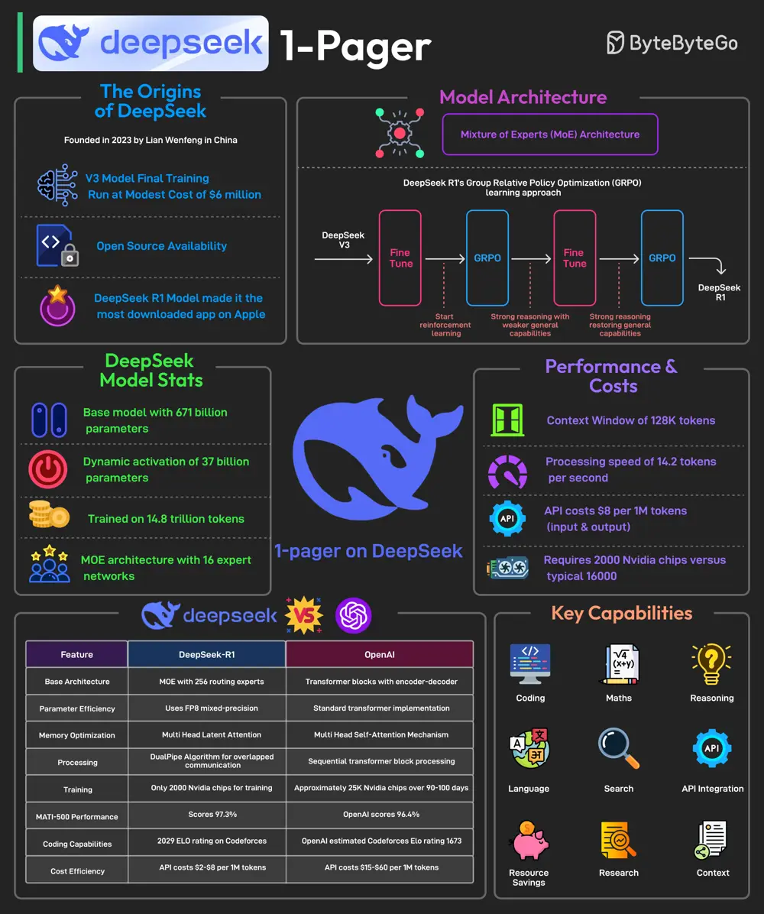

# ByteByteGo System Design 101: DeepSeek 1-Pager

> Copied from <https://github.com/ByteByteGoHq/system-design-101> (CC BY-NC-ND 4.0, by ByteByteGo). Questions and answers are the source's own; nothing was answered or rewritten here.

It is said to have developed a powerful AI model at a remarkably low cost, approximately $6 million for the final training run. In January 2025, it is said to have released its latest reasoning-focused model known as DeepSeek R1.

The release made it the No. 1 downloaded free app on the Apple Play Store.

Most AI models are trained using supervised fine-tuning, meaning they learn by mimicking large datasets of human-annotated examples. This method has limitations.

DeepSeek R1 overcomes these limitations by using Group Relative Policy Optimization (GRPO), a reinforcement learning technique that improves reasoning efficiency by comparing multiple possible answers within the same context.

Some facts about DeepSeek’s R1 model are as follows:

- DeepSeek-R1 uses a Mixture-of-Experts (MoE) architecture with 671 billion total parameters, activating only 37 billion parameters per task.
- It employs selective parameter activation through MoE for resource optimization.
- The model is pre-trained on 14.8 trillion tokens across 52 languages.
- DeepSeek-R1 was trained using just 2000 Nvidia GPUs. By comparison, ChatGPT-4 needed approximately 25K Nvidia GPUs over 90-100 days.
- The model is 85-90% more cost-effective than competitors.
- It excels in mathematics, coding, and reasoning tasks.
- Also, the model has been released as open-source under the MIT license.
