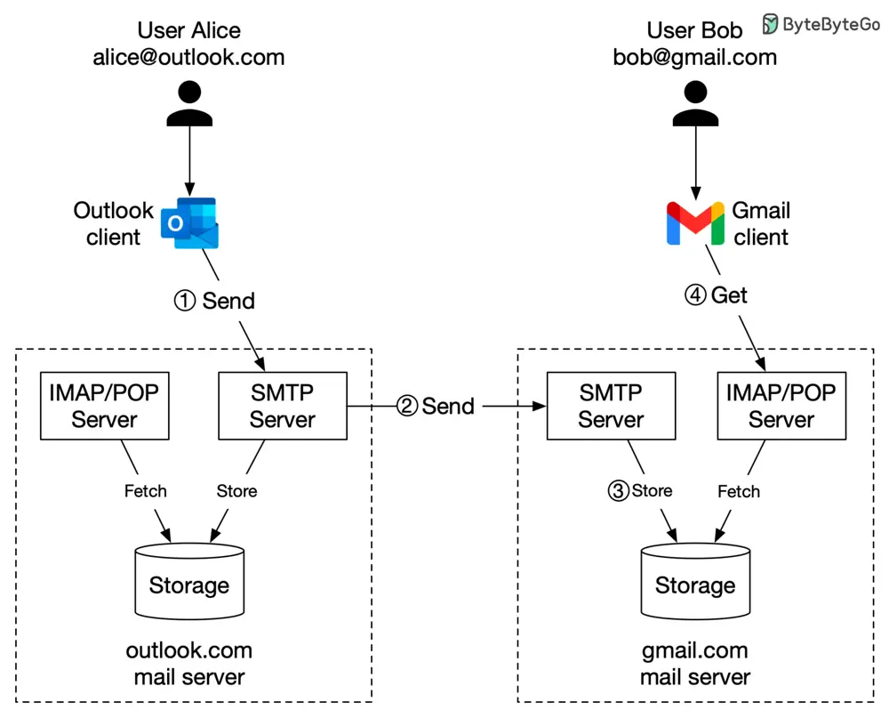

# ByteByteGo System Design 101: Design Gmail

> Copied from <https://github.com/ByteByteGoHq/system-design-101> (CC BY-NC-ND 4.0, by ByteByteGo). Questions and answers are the source's own; nothing was answered or rewritten here.

One picture is worth more than a thousand words. In this post, we will take a look at what happens when Alice sends an email to Bob.

## Sending an Email: A Step-by-Step Guide

1.  Alice logs in to her Outlook client, composes an email, and presses “send”. The email is sent to the Outlook mail server. The communication protocol between the Outlook client and mail server is SMTP.

2.  Outlook mail server queries the DNS (not shown in the diagram) to find the address of the recipient’s SMTP server. In this case, it is Gmail’s SMTP server. Next, it transfers the email to the Gmail mail server. The communication protocol between the mail servers is SMTP.

3.  The Gmail server stores the email and makes it available to Bob, the recipient.

4.  Gmail client fetches new emails through the IMAP/POP server when Bob logs in to Gmail.
