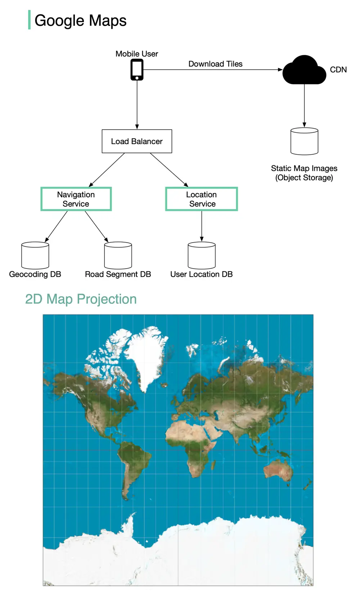

# ByteByteGo System Design 101: Design Google Maps

> Copied from <https://github.com/ByteByteGoHq/system-design-101> (CC BY-NC-ND 4.0, by ByteByteGo). Questions and answers are the source's own; nothing was answered or rewritten here.

Google started project **Google Maps** in 2005. As of March 2021, Google Maps had one billion daily active users, 99% coverage of the world.

Although Google Maps is a very complex system, we can break it down into 3 high-level components. In this post, let’s take a look at how to design a simplified Google Maps.

## Location Service

The location service is responsible for recording a user’s location update. The Google Map clients send location updates every few seconds. The user location data is used in many cases:

*   detect new and recently closed roads.
*   improve the accuracy of the map over time.
*   used as an input for live traffic data.

## Map Rendering

The world’s map is projected into a huge 2D map image. It is broken down into small image blocks called “tiles” (see below). The tiles are static. They don’t change very often. An efficient way to serve static tile files is with a CDN backed by cloud storage like S3. The users can load the necessary tiles to compose a map from nearby CDN.

What if a user is zooming and panning the map viewpoint on the client to explore their surroundings?

An efficient way is to pre-calculate the map blocks with different zoom levels and load the images when needed.

## Navigation Service

This component is responsible for finding a reasonably fast route from point A to point B. It calls two services to help with the path calculation:

1.  Geocoding Service: resolve the given address to a latitude/longitude pair.
2.  Route Planner Service: this service does three things in sequence:

    *   Calculate top-K shortest paths between A and B
    *   Calculate the estimation of time for each path based on current traffic and historical data
    *   Rank the paths by time predictions and user filtering. For example, the user doesn’t want to avoid tolls.
