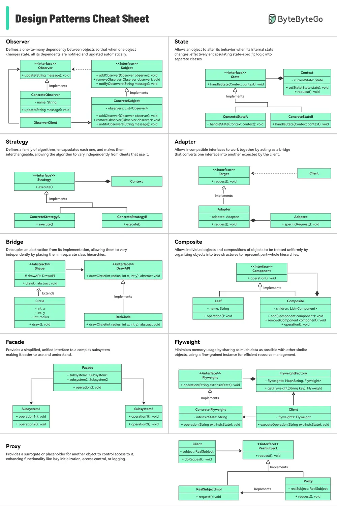

# ByteByteGo System Design 101: Design Patterns Cheat Sheet

> Copied from <https://github.com/ByteByteGoHq/system-design-101> (CC BY-NC-ND 4.0, by ByteByteGo). Questions and answers are the source's own; nothing was answered or rewritten here.

The cheat sheet briefly explains each pattern and how to use it.

What's included?

*   Factory
*   Builder
*   Prototype
*   Singleton
*   Chain of Responsibility
*   And many more!
