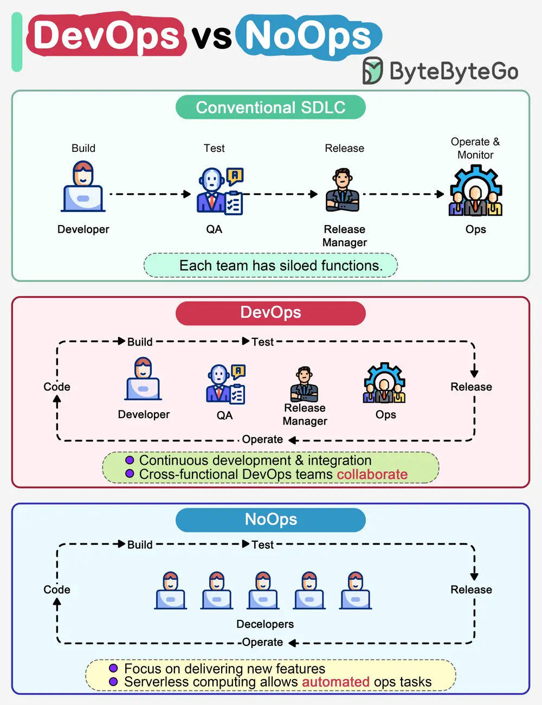

# ByteByteGo System Design 101: DevOps vs NoOps: What's the Difference?

> Copied from <https://github.com/ByteByteGoHq/system-design-101> (CC BY-NC-ND 4.0, by ByteByteGo). Questions and answers are the source's own; nothing was answered or rewritten here.

The diagram below compares traditional SDLC, DevOps and NoOps.

In a traditional software development, code, build, test, release and monitoring are siloed functions. Each stage works independently and hands over to the next stage.

DevOps, on the other hand, encourages continuous development and collaboration between developers and operations. This shortens the overall life cycle and provides continuous software delivery.

NoOps is a newer concept with the development of serverless computing. Since we can architect the system using FaaS (Function-as-a-Service) and BaaS (Backend-as-a-Service), the cloud service providers can take care of most operations tasks. The developers can focus on feature development and automate operations tasks.

NoOps is a pragmatic and effective methodology for startups or smaller-scale applications, which moves shortens the SDLC even more than DevOps.
