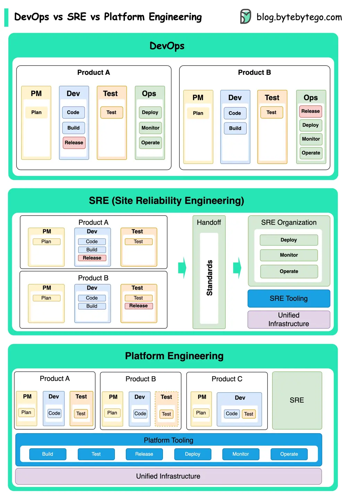

# ByteByteGo System Design 101: DevOps vs. SRE vs. Platform Engineering

> Copied from <https://github.com/ByteByteGoHq/system-design-101> (CC BY-NC-ND 4.0, by ByteByteGo). Questions and answers are the source's own; nothing was answered or rewritten here.

The concepts of DevOps, SRE, and Platform Engineering have emerged at different times and have been developed by various individuals and organizations.

By guest author [Xiong Wang](https://www.linkedin.com/in/wangxiong/)

## Introduction

DevOps as a concept was introduced in 2009 by Patrick Debois and Andrew Shafer at the Agile conference. They sought to bridge the gap between software development and operations by promoting a collaborative culture and shared responsibility for the entire software development lifecycle.

SRE, or Site Reliability Engineering, was pioneered by Google in the early 2000s to address operational challenges in managing large-scale, complex systems. Google developed SRE practices and tools, such as the Borg cluster management system and the Monarch monitoring system, to improve the reliability and efficiency of their services.

Platform Engineering is a more recent concept, building on the foundation of SRE engineering. The precise origins of Platform Engineering are less clear, but it is generally understood to be an extension of the DevOps and SRE practices, with a focus on delivering a comprehensive platform for product development that supports the entire business perspective.

It's worth noting that while these concepts emerged at different times. They are all related to the broader trend of improving collaboration, automation, and efficiency in software development and operations.
