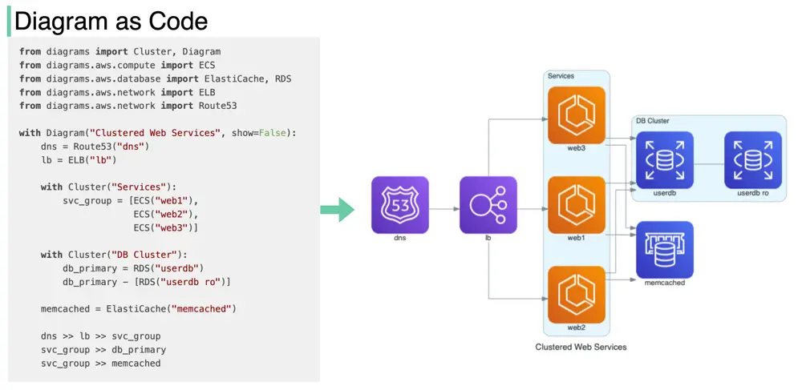

# ByteByteGo System Design 101: Diagram as Code

> Copied from <https://github.com/ByteByteGoHq/system-design-101> (CC BY-NC-ND 4.0, by ByteByteGo). Questions and answers are the source's own; nothing was answered or rewritten here.

Would it be nice if the code we wrote automatically turned into architecture diagrams?

I recently discovered a Github repo that does exactly this: Diagram as Code for prototyping cloud system architectures.

## What does it do?

*   Draw the cloud system architecture in Python code.

*   Diagrams can also be rendered directly inside the Jupyter Notebooks.

*   No design tools are needed.

*   Supports the following providers: AWS, Azure, GCP, Kubernetes, Alibaba Cloud, Oracle Cloud, etc.
