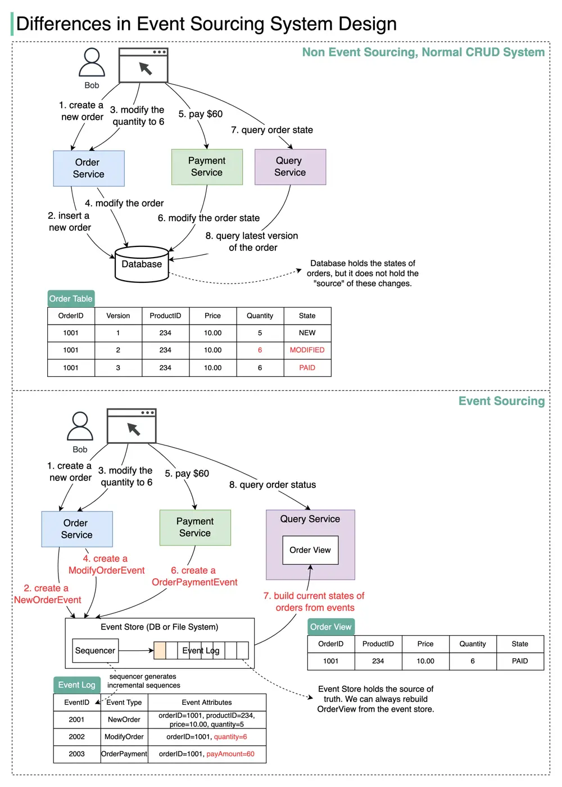

# ByteByteGo System Design 101: Differences in Event Sourcing System Design

> Copied from <https://github.com/ByteByteGoHq/system-design-101> (CC BY-NC-ND 4.0, by ByteByteGo). Questions and answers are the source's own; nothing was answered or rewritten here.

How do we design a system using the event sourcing paradigm? How is it different from normal system design? What are the benefits? We will talk about it in this post.

The diagram above shows the comparison of a normal CRUD system design with an event sourcing system design. We use an e-commerce system that can place orders and pay for the orders to demonstrate how event sourcing works.

The event sourcing paradigm is used to design a system with determinism. This changes the philosophy of normal system designs.
