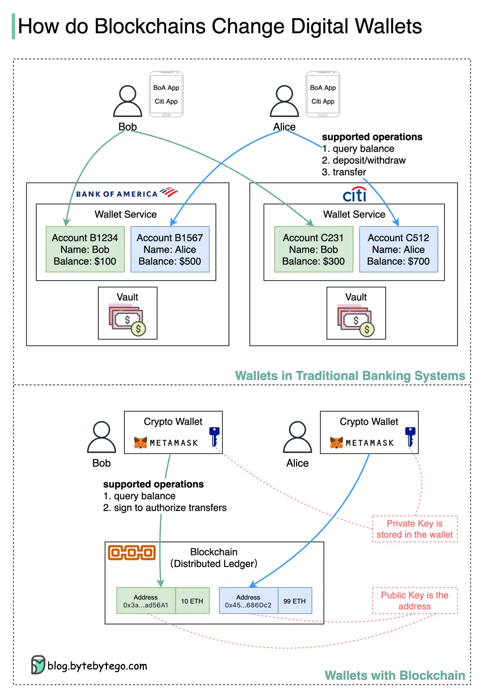

# ByteByteGo System Design 101: Digital Wallets: Banks vs. Blockchain

> Copied from <https://github.com/ByteByteGoHq/system-design-101> (CC BY-NC-ND 4.0, by ByteByteGo). Questions and answers are the source's own; nothing was answered or rewritten here.

How does blockchain change the design of digital wallets? Why do VISA and PayPal invest in blockchains?

## In banking systems

*   Deposit process: Bob goes to Bank of America (BoA) to open an account and deposit $100. A new account B1234 is created in the wallet system for Bob. The cash goes to the bank’s vault and Bob’s wallet now has $100. If Bob wants to use the banking services of Citibank (Citi,) he needs to go through the same process all over again.

*   Transfer process: Bob opens BoA’s App and transfers $50 to Alice’s account at Citi. The amount is deducted from Bob’s account B1234 and credited to Alice’s account C512. The actual movement of cash doesn’t happen instantly. It happens after BoA and Citi settle all transactions at end-of-day.

*   Withdrawal process: Bob withdraws his remaining $50 from account B1234. The amount is deducted from B1234, and Bob gets the cash.

## With Blockchains

*   Deposit & Withdraw: Blockchains support cryptocurrencies, with no cash involved. Bob needs to generate an address as the transfer recipient and store the private key in a crypto wallet like Metamask. Then Bob can receive cryptocurrencies.

*   Transfer: Bob opens Metamask and enters Alice’s address, and sends it 2 ETHs. Then Bob signs the transaction to authorize the transfer with the private key. When this transaction is confirmed on blockchains, Bob’s address has 8 ETHs and Alice’s address has 101 ETHs.

👉 Can you spot the differences?

Blockchain is distributed ledger. It provides a unified interface to handle the common operations we perform on wallets. Instead of opening multiple accounts with different banks, we just need to open a single account on blockchains, which is the address.

All transfers are confirmed on blockchains in pseudo real-time, saving us from waiting until end-of-day reconciliations.

With blockchains, we can merge wallet services from different banks into one global service.
