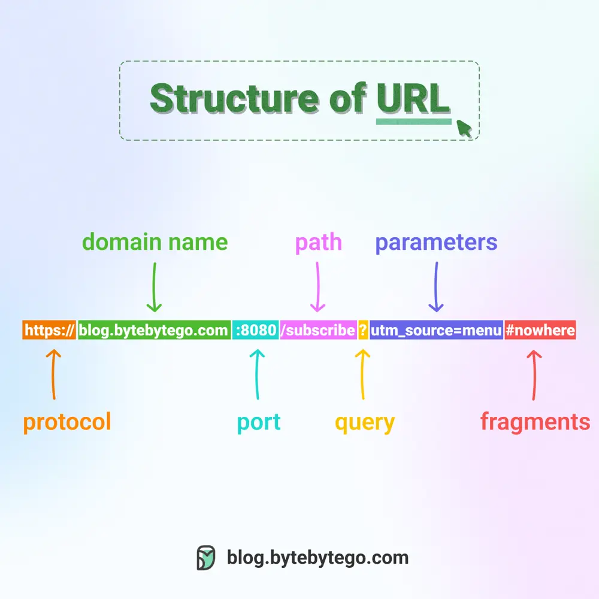

# ByteByteGo System Design 101: Do you know all the components of a URL?

> Copied from <https://github.com/ByteByteGoHq/system-design-101> (CC BY-NC-ND 4.0, by ByteByteGo). Questions and answers are the source's own; nothing was answered or rewritten here.

Uniform Resource Locator (URL) is a term familiar to most people, as it is used to locate resources on the internet. When you type a URL into a web browser's address bar, you are accessing a "resource", not just a webpage.

URLs comprise several components:

*   **The protocol or scheme**, such as http, https, and ftp.
*   **The domain name and port**, separated by a period (.)
*   **The path to the resource**, separated by a slash (/)
*   **The parameters**, which start with a question mark (?) and consist of key-value pairs, such as a=b&c=d.
*   **The fragment or anchor**, indicated by a pound sign (#), which is used to bookmark a specific section of the resource.
