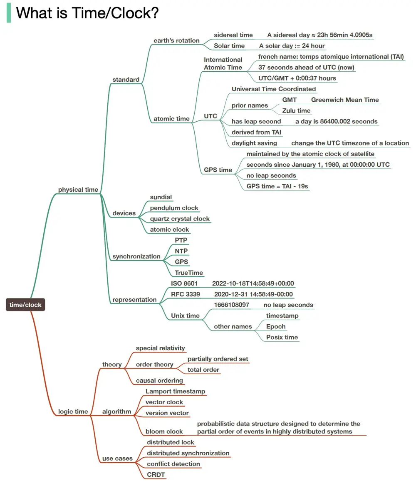

# ByteByteGo System Design 101: Why Meta, Google, and Amazon Stop Using Leap Seconds

> Copied from <https://github.com/ByteByteGoHq/system-design-101> (CC BY-NC-ND 4.0, by ByteByteGo). Questions and answers are the source's own; nothing was answered or rewritten here.

Every few years, there is a special phenomenon that the second after “23:59:59” is not “00:00:00” but “23:59:60”. It is called leap second, which could easily cause time-processing bugs if not handled carefully.

Do we always need to handle leap seconds? It depends on which time representation is used. Commonly used time representations include UTC, GMT, TAI, Unix Timestamp, Epoc time, TrueTime, and GPS time.
