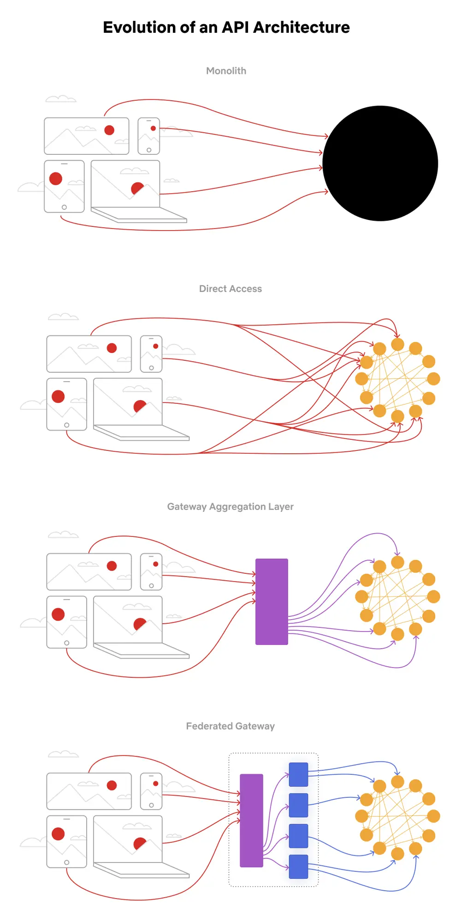

# ByteByteGo System Design 101: Evolution of the Netflix API Architecture

> Copied from <https://github.com/ByteByteGoHq/system-design-101> (CC BY-NC-ND 4.0, by ByteByteGo). Questions and answers are the source's own; nothing was answered or rewritten here.

The Netflix API architecture went through 4 main stages.

**Monolith**. The application is packaged and deployed as a monolith, such as a single Java WAR file, Rails app, etc. Most startups begin with a monolith architecture.

**Direct access**. In this architecture, a client app can make requests directly to the microservices. With hundreds or even thousands of microservices, exposing all of them to clients is not ideal.

**Gateway aggregation layer**. Some use cases may span multiple services, we need a gateway aggregation layer. Imagine the Netflix app needs 3 APIs (movie, production, talent) to render the frontend. The gateway aggregation layer makes it possible.

**Federated gateway**. As the number of developers grew and domain complexity increased, developing the API aggregation layer became increasingly harder. GraphQL federation allows Netflix to set up a single GraphQL gateway that fetches data from all the other APIs.
