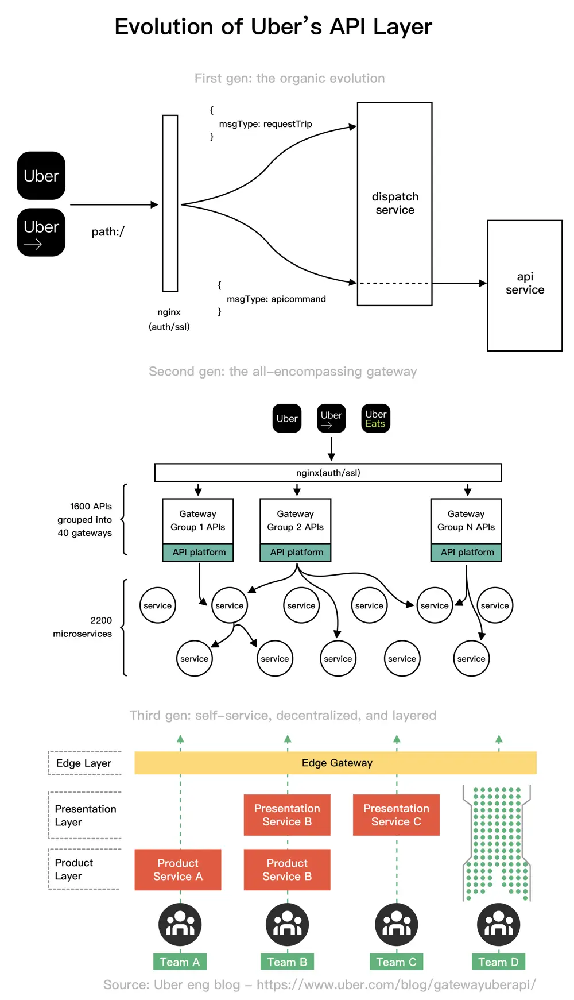

# ByteByteGo System Design 101: Evolution of Uber's API Layer

> Copied from <https://github.com/ByteByteGoHq/system-design-101> (CC BY-NC-ND 4.0, by ByteByteGo). Questions and answers are the source's own; nothing was answered or rewritten here.

Uber’s API gateway went through 3 main stages.

First gen: the organic evolution. Uber's architecture in 2014 would have two key services: dispatch and API. A dispatch service connects a rider with a driver, while an API service stores the long-term data of users and trips.

Second gen: the all-encompassing gateway. Uber adopted a microservice architecture very early on. By 2019, Uber's products were powered by 2,200+ microservices as a result of this architectural decision.

Third gen: self-service, decentralized, and layered. As of early 2018, Uber had completely new business lines and numerous new applications. Freight, ATG, Elevate, groceries, and more are among the growing business lines. With a new set of goals comes the third generation.
