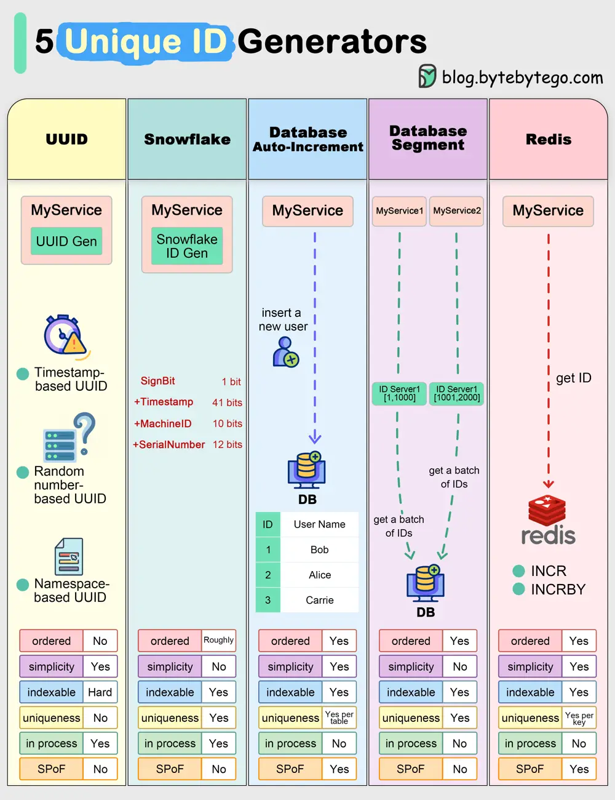

# ByteByteGo System Design 101: Explaining 5 Unique ID Generators

> Copied from <https://github.com/ByteByteGoHq/system-design-101> (CC BY-NC-ND 4.0, by ByteByteGo). Questions and answers are the source's own; nothing was answered or rewritten here.

The diagram below shows how they work. Each generator has its pros and cons.

## UUID

A UUID has 128 bits. It is simple to generate and no need to call another service. However, it is not sequential and inefficient for database indexing. Additionally, UUID doesn’t guarantee global uniqueness. We need to be careful with ID conflicts (although the chances are slim.)

## Snowflake

Snowflake’s ID generation process has multiple components: timestamp, machine ID, and serial number. The first bit is unused to ensure positive IDs. This generator doesn’t need to talk to an ID generator via the network, so is fast and scalable.

Snowflake implementations vary. For example, data center ID can be added to the “MachineID” component to guarantee global uniqueness.

## DB auto-increment

Most database products offer auto-increment identity columns. Since this is supported in the database, we can leverage its transaction management to handle concurrent visits to the ID generator. This guarantees uniqueness in one table. However, this involves network communications and may expose sensitive business data to the outside. For example, if we use this as a user ID, our business competitors will have a rough idea of the total number of users registered on our website.

## DB segment

An alternative approach is to retrieve IDs from the database in batches and cache them in the ID servers, each ID server handling a segment of IDs. This greatly saves the I/O pressure on the database.

## Redis

We can also use Redis key-value pair to generate unique IDs. Redis stores data in memory, so this approach offers better performance than the database.
