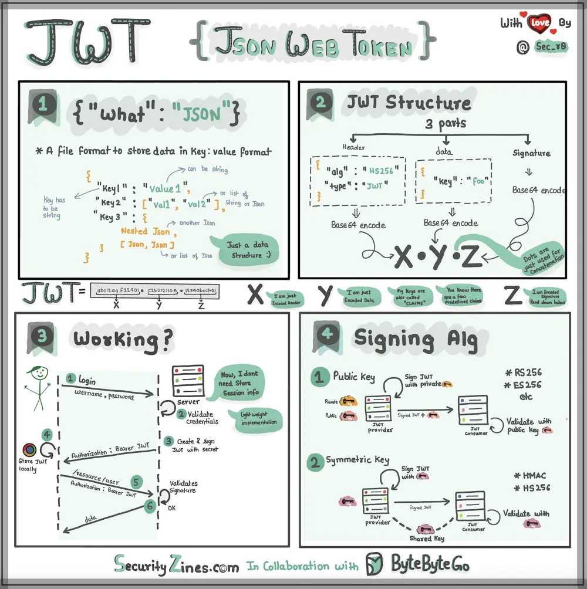

# ByteByteGo System Design 101: Explaining JSON Web Token (JWT) to a 10 Year Old Kid

> Copied from <https://github.com/ByteByteGoHq/system-design-101> (CC BY-NC-ND 4.0, by ByteByteGo). Questions and answers are the source's own; nothing was answered or rewritten here.

Imagine you have a special box called a JWT. Inside this box, there are three parts: a header, a payload, and a signature.

The header is like the label on the outside of the box. It tells us what type of box it is and how it's secured. It's usually written in a format called JSON, which is just a way to organize information using curly braces { } and colons :

The payload is like the actual message or information you want to send. It could be your name, age, or any other data you want to share. It's also written in JSON format, so it's easy to understand and work with.

Now, the signature is what makes the JWT secure. It's like a special seal that only the sender knows how to create. The signature is created using a secret code, kind of like a password. This signature ensures that nobody can tamper with the contents of the JWT without the sender knowing about it.

When you want to send the JWT to a server, you put the header, payload, and signature inside the box. Then you send it over to the server. The server can easily read the header and payload to understand who you are and what you want to do.
