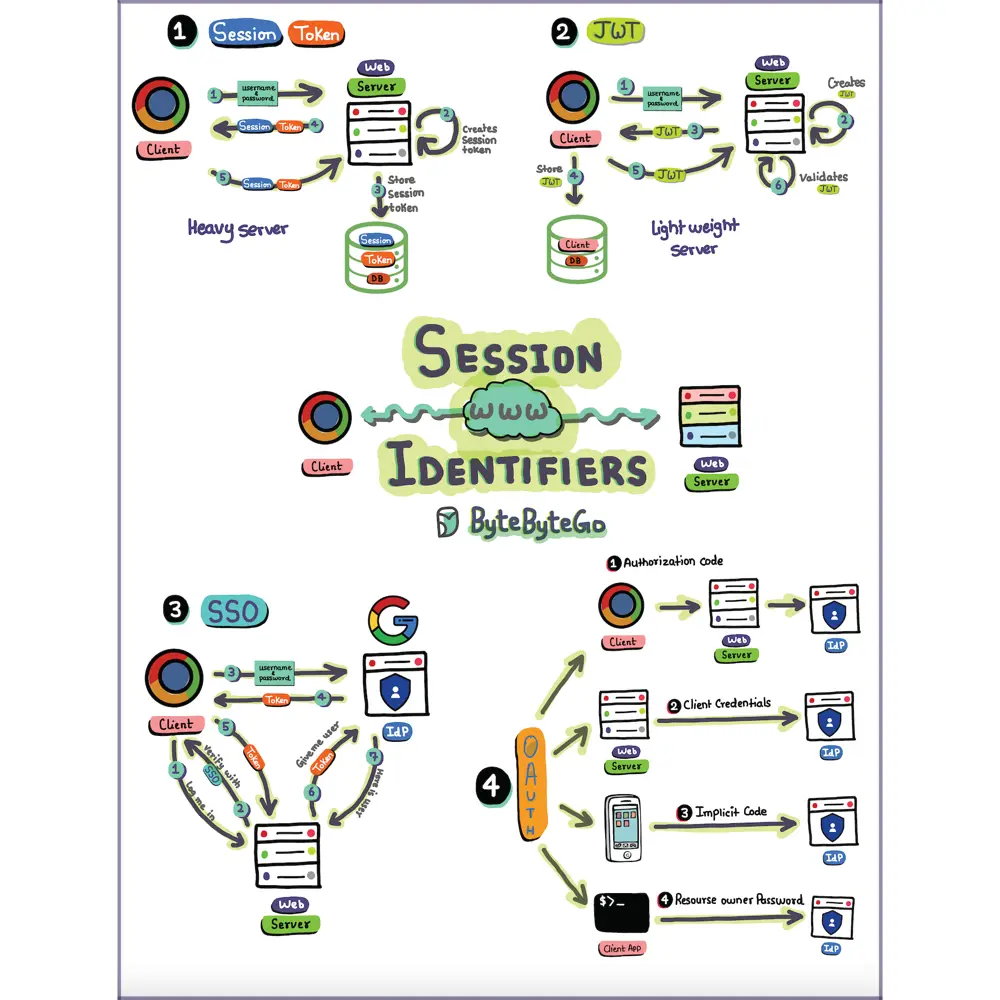

# ByteByteGo System Design 101: Sessions, Tokens, JWT, SSO, and OAuth Explained

> Copied from <https://github.com/ByteByteGoHq/system-design-101> (CC BY-NC-ND 4.0, by ByteByteGo). Questions and answers are the source's own; nothing was answered or rewritten here.

Understanding these backstage maneuvers helps us build secure, seamless experiences.

How do you see the evolution of web session management impacting the future of web applications and user experiences?
