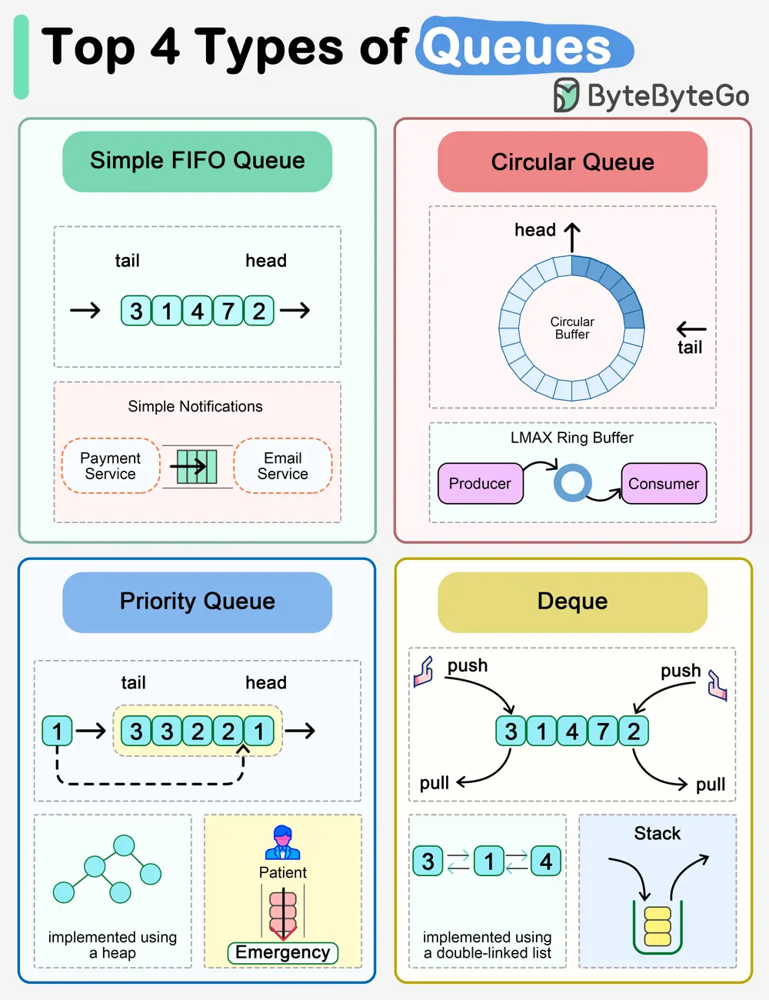

# ByteByteGo System Design 101: Explaining the 4 Most Commonly Used Types of Queues

> Copied from <https://github.com/ByteByteGoHq/system-design-101> (CC BY-NC-ND 4.0, by ByteByteGo). Questions and answers are the source's own; nothing was answered or rewritten here.

Queues are popular data structures used widely in the system. The diagram above shows 4 different types of queues we often use.

## Simple FIFO Queue

A simple queue follows FIFO (First In First Out). A new element is inserted at the tail of the queue, and an element is removed from the head of the queue.

If we would like to send out email notifications to the users whenever we receive a payment response, we can use a FIFO queue. The emails will be sent out in the same order as the payment responses.

## Circular Queue

A circular queue is also called a circular buffer or a ring buffer. Its last element is linked to the first element. Insertion takes place at the front of the queue and deletion at the end of the queue.

A famous implementation is LMAX’s low-latency ring buffer. Trading components talk to each other via a ring buffer. This is implemented in memory and super fast.

## Priority Queue

The elements in a priority queue have predefined priorities. We take the element with the highest (or lowest) priority from the queue. Under the hood, it is implemented using a max heap or a min heap where the element with the largest or lowest priority is at the root of the heap.

A typical use case is assigning patients with the highest severity to the emergency room while others to the regular rooms.

## Deque

Deque is also called double-ended queue. The insertion and deletion can happen at both the head and the tail. Deque supports both FIFO and LIFO (Last In First Out), so we can use it to implement a stack data structure.
