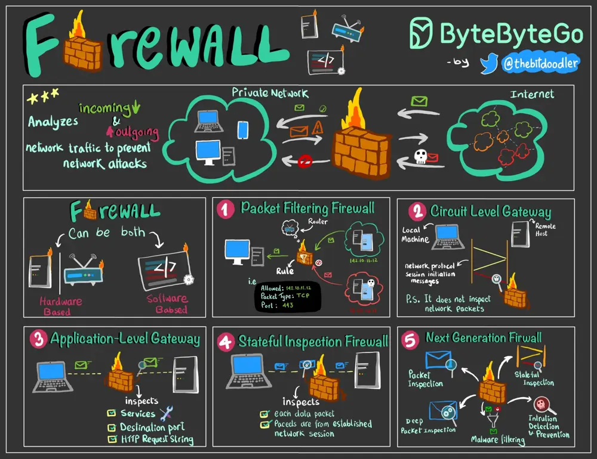

# ByteByteGo System Design 101: Firewall Explained to Kids and Adults

> Copied from <https://github.com/ByteByteGoHq/system-design-101> (CC BY-NC-ND 4.0, by ByteByteGo). Questions and answers are the source's own; nothing was answered or rewritten here.

A firewall is a network security system that controls and filters network traffic, acting as a watchman between a private network and the public Internet.

They come in two broad categories:

*   Software-based: installed on individual devices for protection

*   Hardware-based: stand-alone devices that safeguard an entire network.

Firewalls have several types, each designed for specific security needs:

### Packet Filtering Firewalls

Examines packets of data, accepting or rejecting based on source, destination, or protocols.

### Circuit-level Gateways

Monitors TCP handshake between packets to determine session legitimacy.

### Application-level Gateways (Proxy Firewalls)

Filters incoming traffic between your network and traffic source, offering a protective shield against untrusted networks.

### Stateful Inspection Firewalls

Tracks active connections to determine which packets to allow, analyzing in the context of their place in a data stream.

### Next-Generation Firewalls (NGFWs)

Advanced firewalls that integrate traditional methods with functionalities like intrusion prevention systems, deep packet analysis, and application awareness.
