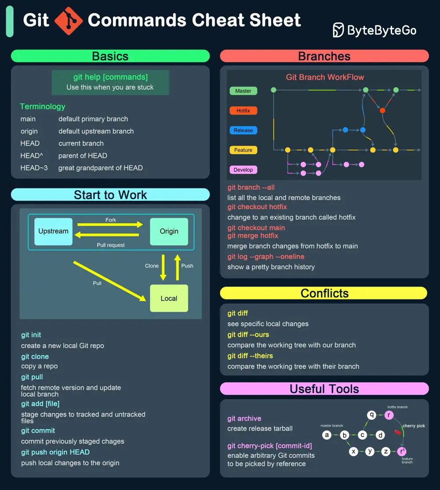

# ByteByteGo System Design 101: Git Commands Cheat Sheet

> Copied from <https://github.com/ByteByteGoHq/system-design-101> (CC BY-NC-ND 4.0, by ByteByteGo). Questions and answers are the source's own; nothing was answered or rewritten here.

## Getting Started

*   **git init**: Initializes a new Git repository.

*   **git clone [url]**: Clones a repository from a remote URL.

## Making Changes

*   **git add [file]**: Adds a file to the staging area.

*   **git commit -m "[message]"**: Commits changes with a descriptive message.

*   **git status**: Shows the status of the working directory.

*   **git diff**: Shows the differences between the working directory and the staging area.

## Branching and Merging

*   **git branch**: Lists all local branches.

*   **git branch [branch-name]**: Creates a new branch.

*   **git checkout [branch-name]**: Switches to the specified branch.

*   **git merge [branch-name]**: Merges the specified branch into the current branch.

*   **git branch -d [branch-name]**: Deletes the specified branch.

## Remote Repositories

*   **git remote add origin [url]**: Adds a remote repository.

*   **git push origin [branch-name]**: Pushes changes to the remote repository.

*   **git pull origin [branch-name]**: Pulls changes from the remote repository.

*   **git fetch**: Fetches changes from the remote repository without merging.

## Undoing Changes

*   **git reset [file]**: Unstages a file.

*   **git checkout -- [file]**: Discards changes to a file.

*   **git revert [commit]**: Creates a new commit that undoes the changes from the specified commit.
