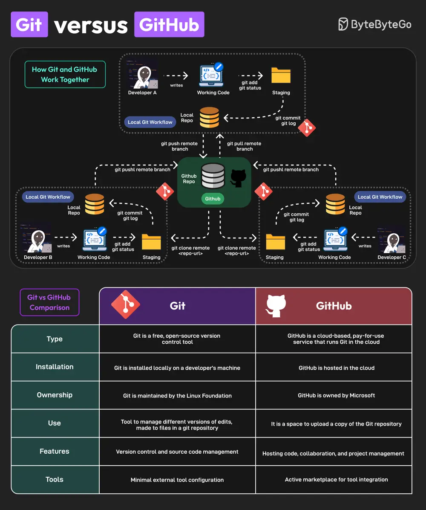

# ByteByteGo System Design 101: Git vs GitHub

> Copied from <https://github.com/ByteByteGoHq/system-design-101> (CC BY-NC-ND 4.0, by ByteByteGo). Questions and answers are the source's own; nothing was answered or rewritten here.

Git and GitHub are popular tools for version control. They work together and complement each other to provide effective source control management.

On a high level, Git is focused on version control and code sharing, whereas GitHub is focused on centralized source code hosting for sharing with other developers.

However, they have some key differences

## Key Differences

*   Git is a free, open-source version control tool. GitHub is a cloud-based, pay-for-use service that runs Git in the cloud.

*   Git is installed locally on a developer’s machine. GitHub is hosted in the cloud.

*   The Linux Foundation maintains Git. Microsoft owns GitHub.

*   Git can manage different versions of edits, made to files in a git repository. GitHub is a space to upload a copy of the Git repository.

*   Git supports version control and source code management. GitHub can be used for hosting code, collaboration, and project management.

*   Git has minimal external tool configuration. GitHub provides an active marketplace for tool integration.

Lastly, you can use Git without GitHub but you cannot use GitHub without Git.
