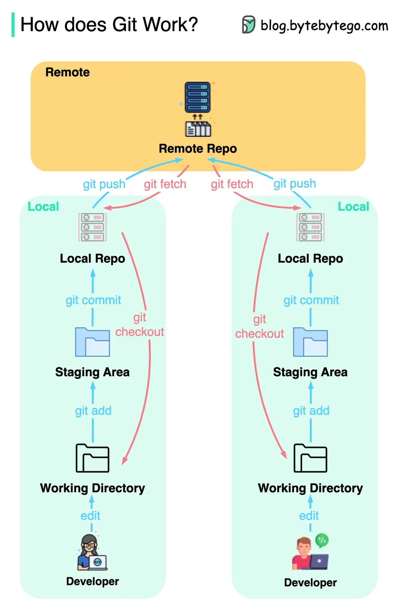

# ByteByteGo System Design 101: How does Git Work?

> Copied from <https://github.com/ByteByteGoHq/system-design-101> (CC BY-NC-ND 4.0, by ByteByteGo). Questions and answers are the source's own; nothing was answered or rewritten here.

Git is a distributed version control system that allows multiple developers to work on the same project simultaneously. It is widely used in software development to manage source code history.

The diagram above shows the Git workflow with common commands.