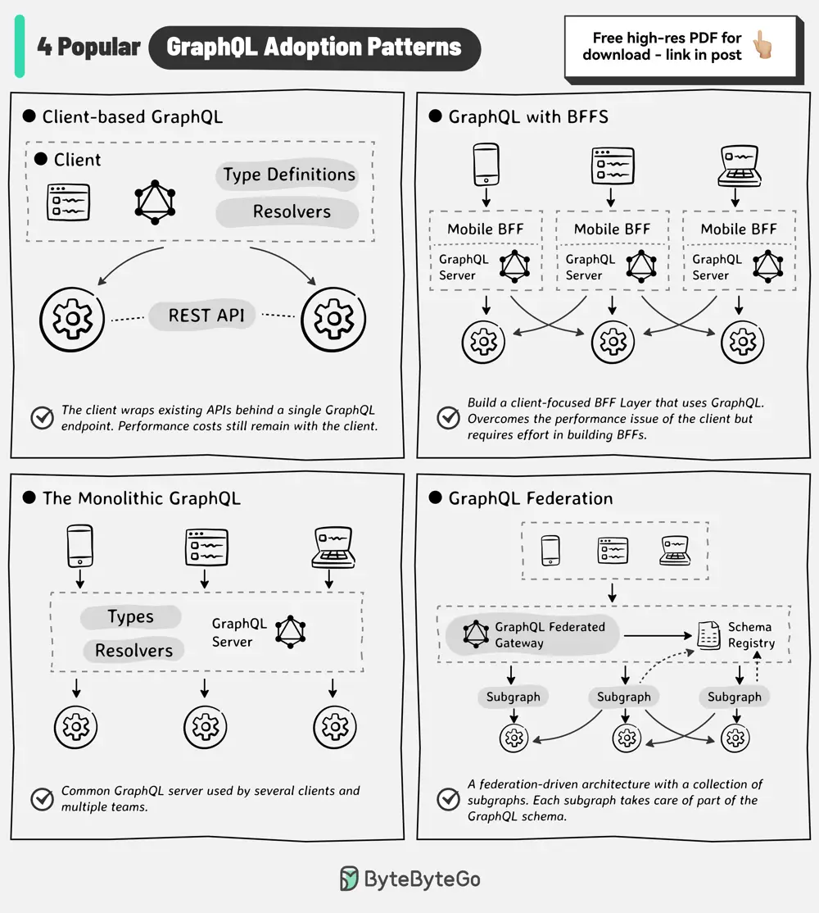

# ByteByteGo System Design 101: GraphQL Adoption Patterns

> Copied from <https://github.com/ByteByteGoHq/system-design-101> (CC BY-NC-ND 4.0, by ByteByteGo). Questions and answers are the source's own; nothing was answered or rewritten here.

Typically, teams begin their GraphQL journey with a basic architecture where a client application queries a single GraphQL server.

However, multiple patterns are available:

*   **Client-based GraphQL**

    The client wraps existing APIs behind a single GraphQL endpoint. This approach improves the developer experience but the client still bears the performance costs of aggregating data.

*   **GraphQL with BFFs**

    BFF or Backend-for-Frontends adds a new layer where each client has a dedicated BFF service. GraphQL is a natural fit to build a client-focused intermediary layer.

    Performance and developer experience for the clients is improved but there’s a tradeoff in building and maintaining BFFs.

*   **The Monolithic GraphQL**

    Multiple teams share one codebase for a GraphQL server used by several clients. Also, a single team owns a GraphQL API that is accessed by multiple client teams.

*   **GraphQL Federation**

    This involves consolidating multiple graphs into a supergraph.

    GraphQL Federated Gateway takes care of routing the requests to the downstream subgraph services that take care of a specific part of the GraphQL schema. This approach maintains ownership of data with the domain team while avoiding duplication of effort.

Over to you: Which GraphQL adoption approach have you seen or used?
