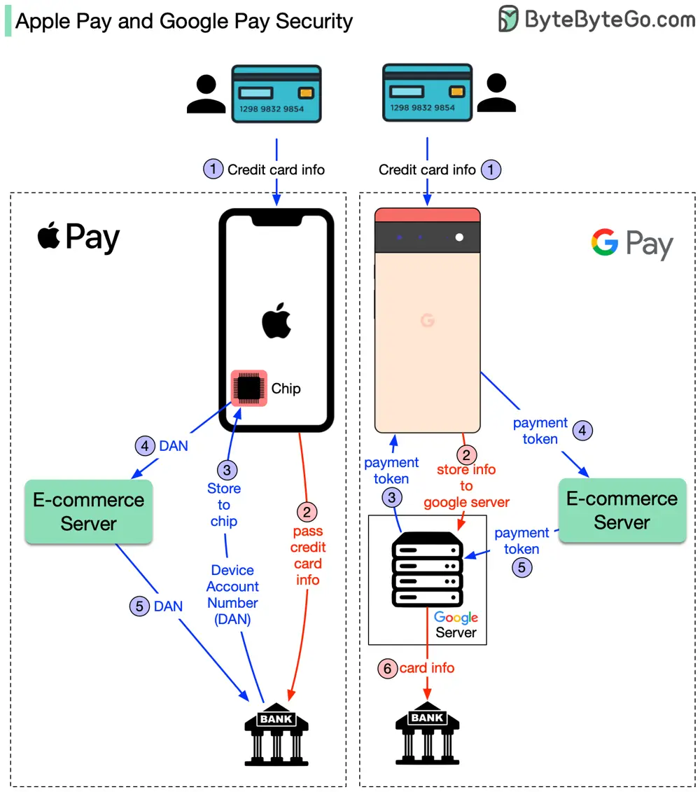

# ByteByteGo System Design 101: How do Apple Pay and Google Pay work?

> Copied from <https://github.com/ByteByteGoHq/system-design-101> (CC BY-NC-ND 4.0, by ByteByteGo). Questions and answers are the source's own; nothing was answered or rewritten here.

The diagram above shows the differences. Both approaches are very secure, but the implementations are different. To understand the difference, we break down the process into two flows.

## Registering your credit card flow

## Basic payment flow

1.  The registration flow is represented by steps 1~3 for both cases. The difference is:

*   **Apple Pay:** Apple doesn’t store any card info. It passes the card info to the bank. Bank returns a token called DAN (device account number) to the iPhone. iPhone then stores DAN into a special hardware chip.

*   **Google Pay:** When you register the credit card with Google Pay, the card info is stored in the Google server. Google returns a payment token to the phone.

2.  When you click the “Pay” button on your phone, the basic payment flow starts. Here are the differences:

*   **Apple Pay:** For iPhone, the e-commerce server passes the DAN to the bank.

*   **Google Pay:** In the Google Pay case, the e-commerce server passes the payment token to the Google server. Google server looks up the credit card info and passes it to the bank.

In the diagram, the red arrow means the credit card info is available on the public network, although it is encrypted.

References:

[1] [Apple Pay security and privacy overview](https://support.apple.com/en-us/101554)

[2] [Google Pay for Payments](https://developers.google.com/pay/api/android/overview)

[3] [Apple Pay vs. Google Pay: How They Work](https://www.investopedia.com/articles/personal-finance/010215/apple-pay-vs-google-wallet-how-they-work.asp)
