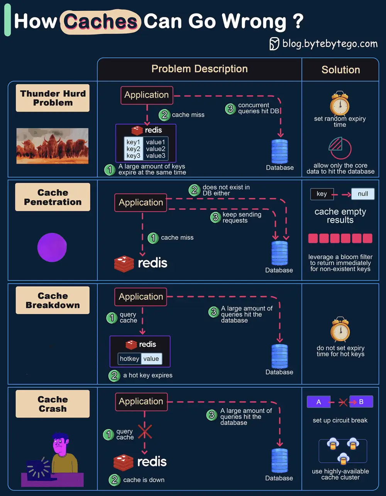

# ByteByteGo System Design 101: How Can Cache Systems Go Wrong?

> Copied from <https://github.com/ByteByteGoHq/system-design-101> (CC BY-NC-ND 4.0, by ByteByteGo). Questions and answers are the source's own; nothing was answered or rewritten here.

The diagram above shows 4 typical cases where caches can go wrong and their solutions.

## 1. Thunder Herd Problem

This happens when a large number of keys in the cache expire at the same time. Then the query requests directly hit the database, which overloads the database.

There are two ways to mitigate this issue: one is to avoid setting the same expiry time for the keys, adding a random number in the configuration; the other is to allow only the core business data to hit the database and prevent non-core data to access the database until the cache is back up.

## 2. Cache Penetration

This happens when the key doesn’t exist in the cache or the database. The application cannot retrieve relevant data from the database to update the cache. This problem creates a lot of pressure on both the cache and the database.

To solve this, there are two suggestions.
*   Cache a null value for non-existent keys, avoiding hitting the database.
*   Use a bloom filter to check the key existence first, and if the key doesn’t exist, we can avoid hitting the database.

## 3. Cache Breakdown

This is similar to the thunder herd problem. It happens when a hot key expires. A large number of requests hit the database.

Since the hot keys take up 80% of the queries, we do not set an expiration time for them.

## 4. Cache Crash

This happens when the cache is down and all the requests go to the database.

There are two ways to solve this problem.
*   Set up a circuit breaker, and when the cache is down, the application services cannot visit the cache or the database.
*   Set up a cluster for the cache to improve cache availability.
