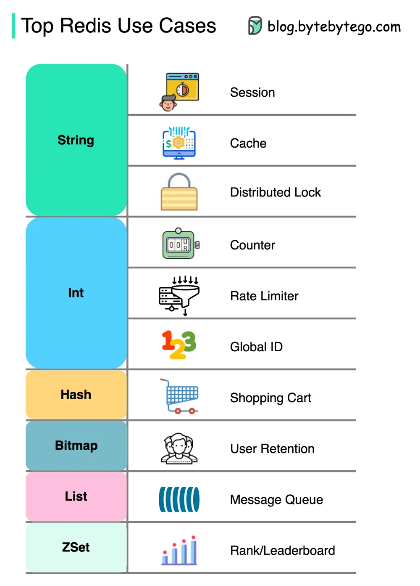

# ByteByteGo System Design 101: How can Redis be used?

> Copied from <https://github.com/ByteByteGoHq/system-design-101> (CC BY-NC-ND 4.0, by ByteByteGo). Questions and answers are the source's own; nothing was answered or rewritten here.

There is more to Redis than just caching.

Redis can be used in a variety of scenarios as shown in the diagram.

*   **Session**

    We can use Redis to share user session data among different services.

*   **Cache**

    We can use Redis to cache objects or pages, especially for hotspot data.

*   **Distributed lock**

    We can use a Redis string to acquire locks among distributed services.

*   **Counter**

    We can count how many likes or how many reads for articles.

*   **Rate limiter**

    We can apply a rate limiter for certain user IPs.

*   **Global ID generator**

    We can use Redis Int for global ID.

*   **Shopping cart**

    We can use Redis Hash to represent key-value pairs in a shopping cart.

*   **Calculate user retention**

    We can use Bitmap to represent the user login daily and calculate user retention.

*   **Message queue**

    We can use List for a message queue.

*   **Ranking**

    We can use ZSet to sort the articles.
