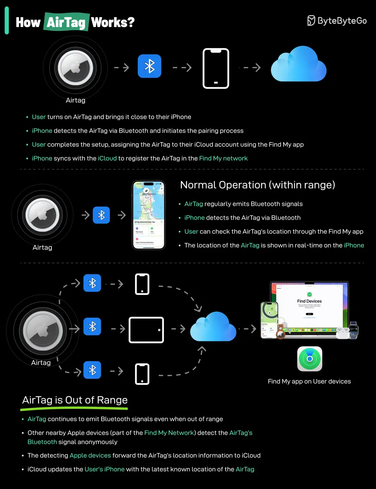

# ByteByteGo System Design 101: How do AirTags work?

> Copied from <https://github.com/ByteByteGoHq/system-design-101> (CC BY-NC-ND 4.0, by ByteByteGo). Questions and answers are the source's own; nothing was answered or rewritten here.

AirTags work by leveraging a combination of Bluetooth technology and the vast network of Apple devices to help you locate your lost items.

Here's a breakdown of how they function:

*   Bluetooth Signal: Each AirTag emits a secure Bluetooth signal that can be detected by nearby Apple devices (iPhones, iPads, etc.) within the Find My network.

*   Find My Network: When an AirTag comes within range of an Apple device in the Find My network, that device anonymously and securely relays the AirTag's location information to iCloud.

*   Location Tracking: You can then use the Find My app on your own Apple device to see the approximate location of your AirTag on a map.

## Limitations

Please note that AirTags rely on Bluetooth technology and the presence of Apple devices within the Find My network. If your AirTag is in an area with few Apple devices, its location may not be updated as frequently or accurately.
