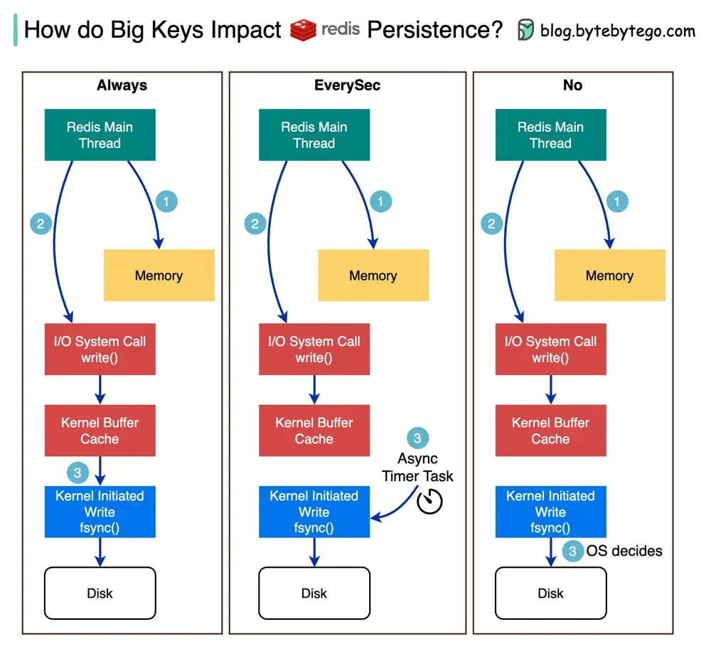

# ByteByteGo System Design 101: How Big Keys Impact Redis Persistence

> Copied from <https://github.com/ByteByteGoHq/system-design-101> (CC BY-NC-ND 4.0, by ByteByteGo). Questions and answers are the source's own; nothing was answered or rewritten here.

We call a key that contains a large size of data a big key. For example, the size of the key is 5 MB.

The diagram shows how big keys impact Redis AOF (Append-Only-File) persistence.

There are three modes when we turn on AOF persistence:

*   Always - synchronously write data to the disk whenever there is a data update in memory.

*   EverySec - write to the disk every second.

*   No - Redis doesn’t control when the data is written to the disk. Instead, the operating system decides when the data is written to the disk.

## How do we analyze the impact of big keys?

Redis writes keys into memory first, then calls write() to write the data into the kernel buffer cache. Then fsync() flushes all modified in-core data of the file to the disk device. There are 3 modes.

In “Always” mode, it calls fsync() synchronously. If we need to update a big key, the main thread will be blocked because it has to wait for the write to complete.

“EveySec” starts a background timer task to call fsync() every second, so big keys have no impact on the Redis main thread.

“No” mode never calls fsync(). It is up to the operating system. Big keys have no impact on the main thread.
