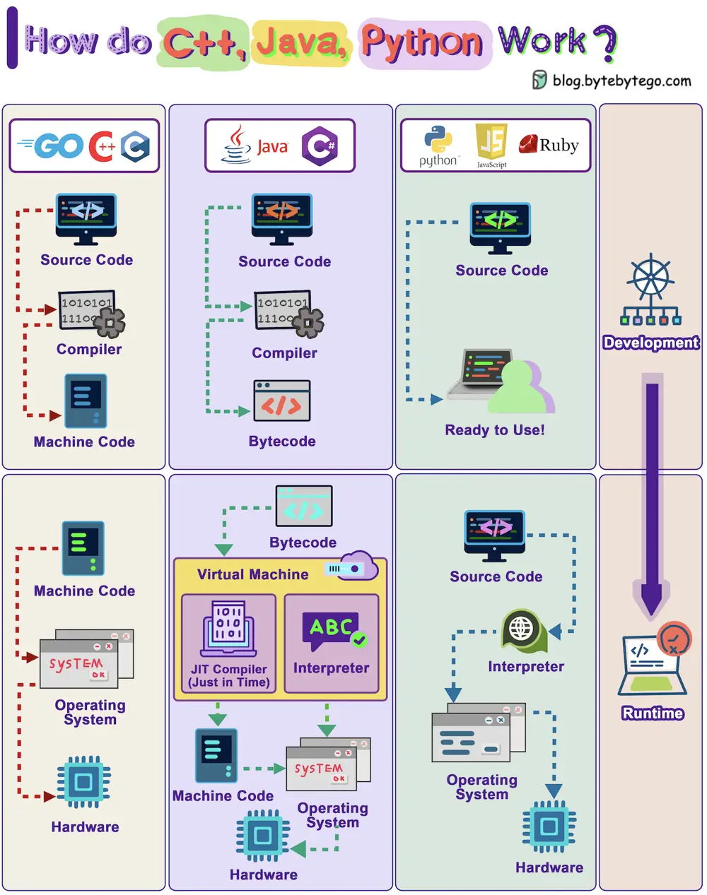

# ByteByteGo System Design 101: How Do C++, Java, Python Work?

> Copied from <https://github.com/ByteByteGoHq/system-design-101> (CC BY-NC-ND 4.0, by ByteByteGo). Questions and answers are the source's own; nothing was answered or rewritten here.

The diagram shows how the compilation and execution work.

Compiled languages are compiled into machine code by the compiler. The machine code can later be executed directly by the CPU. Examples: C, C++, Go.

A bytecode language like Java, compiles the source code into bytecode first, then the JVM executes the program. Sometimes JIT (Just-In-Time) compiler compiles the source code into machine code to speed up the execution. Examples: Java, C#

Interpreted languages are not compiled. They are interpreted by the interpreter during runtime. Examples: Python, Javascript, Ruby

Compiled languages in general run faster than interpreted languages.
