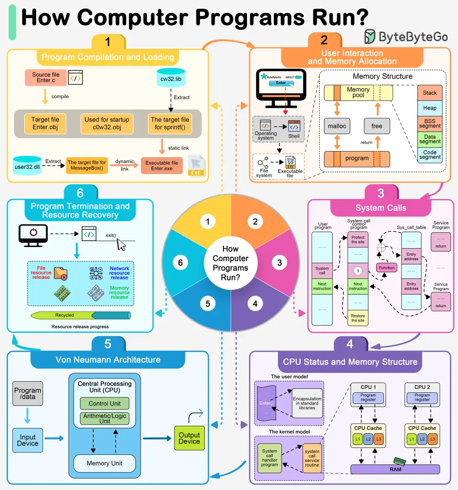

# ByteByteGo System Design 101: How Do Computer Programs Run?

> Copied from <https://github.com/ByteByteGoHq/system-design-101> (CC BY-NC-ND 4.0, by ByteByteGo). Questions and answers are the source's own; nothing was answered or rewritten here.

The diagram shows the steps.

## User Interaction and Command Initiation

By double-clicking a program, a user is instructing the operating system to launch an application via the graphical user interface.

## Program Preloading

Once the execution request has been initiated, the operating system first retrieves the program's executable file.

The operating system locates this file through the file system and loads it into memory in preparation for execution.

## Dependency Resolution and Loading

Most modern applications rely on a number of shared libraries, such as dynamic link libraries (DLLs).

## Allocating Memory Space

The operating system is responsible for allocating space in memory.

## Initializing the Runtime Environment

After allocating memory, the operating system and execution environment (e.g., Java's JVM or the .NET Framework) will initialize various resources needed to run the program.

## System Calls and Resource Management

The entry point of a program (usually a function named `main`) is called to begin execution of the code written by the programmer.

## Von Neumann Architecture

In the Von Neumann architecture, the CPU executes instructions stored in memory.

## Program Termination

Eventually, when the program has completed its task, or the user actively terminates the application, the program will begin a cleanup phase. This includes closing open file descriptors, freeing up network resources, and returning memory to the system.
