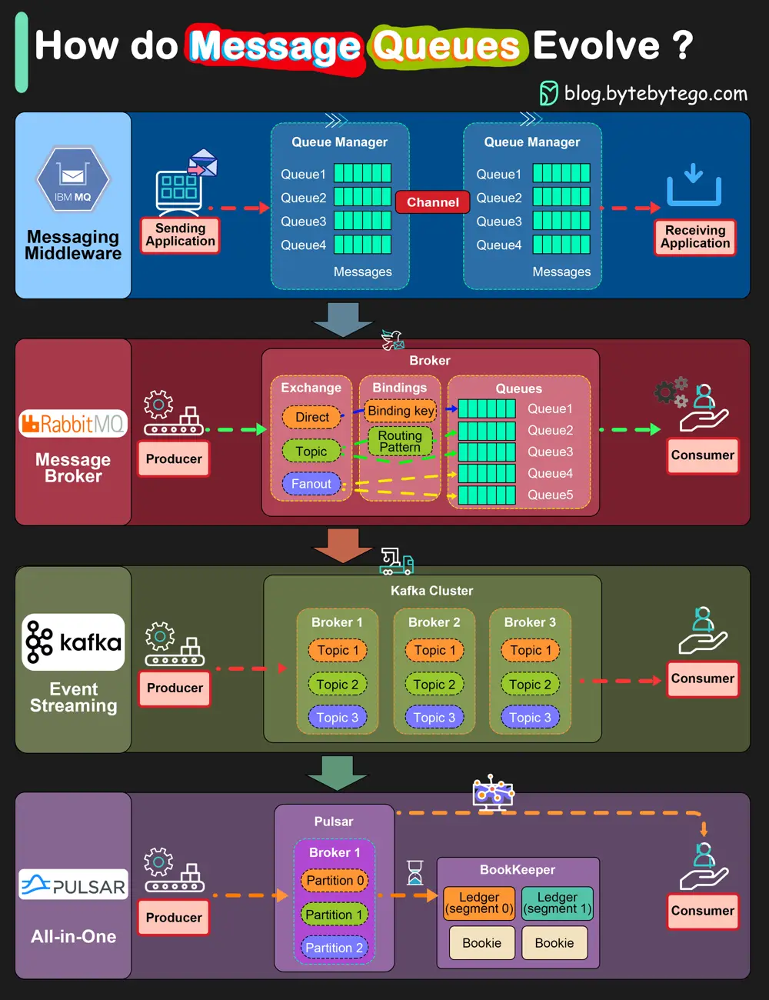

# ByteByteGo System Design 101: IBM MQ -> RabbitMQ -> Kafka -> Pulsar: Message Queue Evolution

> Copied from <https://github.com/ByteByteGoHq/system-design-101> (CC BY-NC-ND 4.0, by ByteByteGo). Questions and answers are the source's own; nothing was answered or rewritten here.

*   IBM MQ

IBM MQ was launched in 1993. It was originally called MQSeries and was renamed WebSphere MQ in 2002. It was renamed to IBM MQ in 2014. IBM MQ is a very successful product widely used in the financial sector. Its revenue still reached 1 billion dollars in 2020.

*   RabbitMQ

RabbitMQ architecture differs from IBM MQ and is more similar to Kafka concepts. The producer publishes a message to an exchange with a specified exchange type. It can be direct, topic, or fanout. The exchange then routes the message into the queues based on different message attributes and the exchange type. The consumers pick up the message accordingly.

*   Kafka

In early 2011, LinkedIn open sourced Kafka, which is a distributed event streaming platform. It was named after Franz Kafka. As the name suggested, Kafka is optimized for writing. It offers a high-throughput, low-latency platform for handling real-time data feeds. It provides a unified event log to enable event streaming and is widely used in internet companies.

Kafka defines producer, broker, topic, partition, and consumer. Its simplicity and fault tolerance allow it to replace previous products like AMQP-based message queues.

*   Pulsar

Pulsar, developed originally by Yahoo, is an all-in-one messaging and streaming platform. Compared with Kafka, Pulsar incorporates many useful features from other products and supports a wide range of capabilities. Also, Pulsar architecture is more cloud-native, providing better support for cluster scaling and partition migration, etc.

There are two layers in Pulsar architecture: the serving layer and the persistent layer. Pulsar natively supports tiered storage, where we can leverage cheaper object storage like AWS S3 to persist messages for a longer term.
