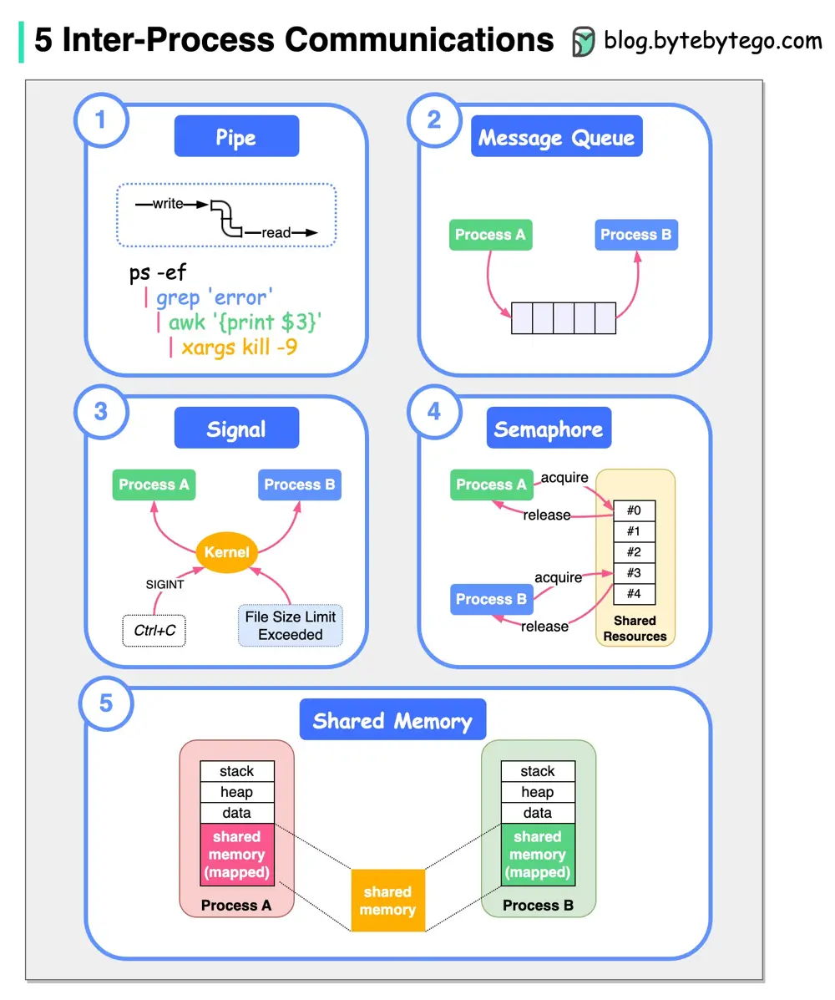

# ByteByteGo System Design 101: Inter-Process Communication on Linux

> Copied from <https://github.com/ByteByteGoHq/system-design-101> (CC BY-NC-ND 4.0, by ByteByteGo). Questions and answers are the source's own; nothing was answered or rewritten here.

The diagram above shows 5 ways of Inter-Process Communication.

## Pipe

Pipes are unidirectional byte streams that connect the standard output from one process to the standard input of another process.

## Message Queue

Message queues allow one or more processes to write messages, which will be read by one or more reading processes.

## Signal

Signals are one of the oldest inter-process communication methods used by Unix systems. A signal could be generated by a keyboard interrupt or an error condition such as the process attempting to access a non-existent location in its virtual memory. There are a set of defined signals that the kernel can generate or that can be generated by other processes in the system. For example, Ctrl+C sends a SIGINT signal to process A.

## Semaphore

A semaphore is a location in memory whose value can be tested and set by more than one process. Depending on the result of the test and set operation one process may have to sleep until the semaphore's value is changed by another process.

## Shared Memory

Shared memory allows one or more processes to communicate via memory that appears in all of their virtual address spaces. When processes no longer wish to share the virtual memory, they detach from it.
