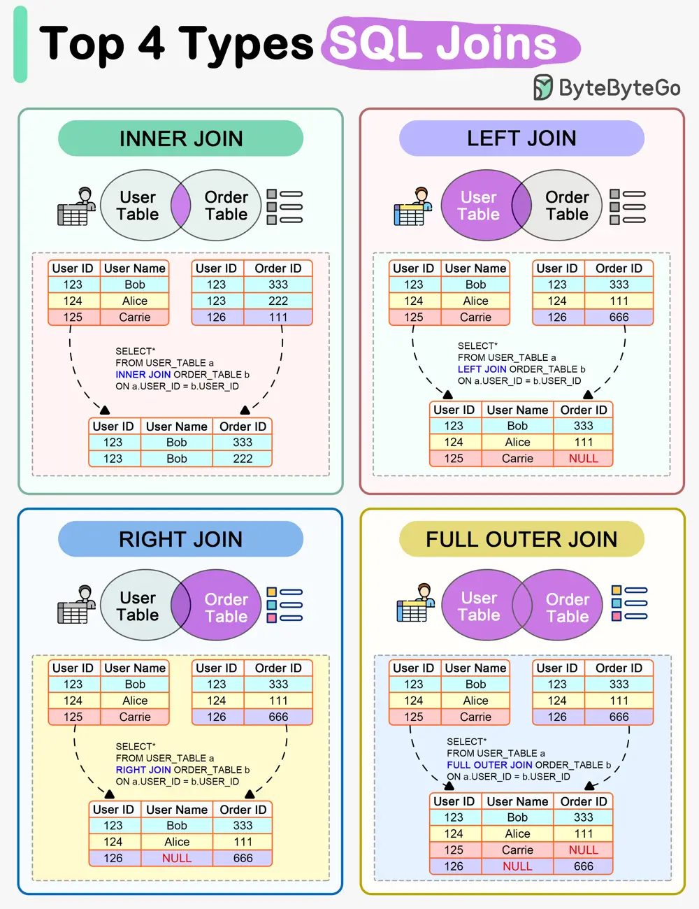

# ByteByteGo System Design 101: How do SQL Joins Work?

> Copied from <https://github.com/ByteByteGoHq/system-design-101> (CC BY-NC-ND 4.0, by ByteByteGo). Questions and answers are the source's own; nothing was answered or rewritten here.

The diagram above shows how 4 types of SQL joins work in detail.

## INNER JOIN

Returns matching rows in both tables.

## LEFT JOIN

Returns all records from the left table, and the matching records from the right table.

## RIGHT JOIN

Returns all records from the right table, and the matching records from the left table.

## FULL OUTER JOIN

Returns all records where there is a match in either left or right table.
