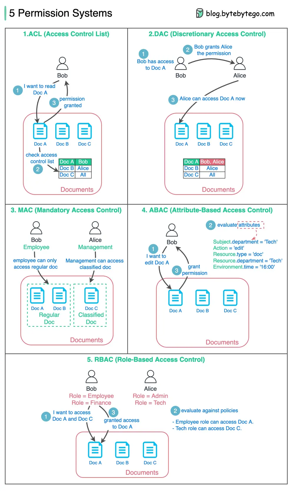

# ByteByteGo System Design 101: Designing a Permission System

> Copied from <https://github.com/ByteByteGoHq/system-design-101> (CC BY-NC-ND 4.0, by ByteByteGo). Questions and answers are the source's own; nothing was answered or rewritten here.

The diagram below lists 5 common ways.

## 1. ACL (Access Control List)

ACL is a list of rules that specifies which users are granted or denied access to a particular resource.

*   Pros - Easy to understand.
*   Cons - error-prone, maintenance cost is high

## 2. DAC (Discretionary Access Control)

This is based on ACL. It grants or restricts object access via an access policy determined by an object's owner group.

*   Pros - Easy and flexible. Linux file system supports DAC.
*   Cons - Scattered permission control, too much power for the object’s owner group.

## 3. MAC (Mandatory Access Control)

Both resource owners and resources have classification labels. Different labels are granted with different permissions.

*   Pros - strict and straightforward.
*   Cons - not flexible.

## 4. ABAC (Attribute-based access control)

Evaluate permissions based on attributes of the Resource owner, Action, Resource, and Environment.

*   Pros - flexible
*   Cons - the rules can be complicated, and the implementation is hard. It is not commonly used.

## 5. RBAC (Role-based Access Control)

Evaluate permissions based on roles

*   Pros - flexible in assigning roles.
