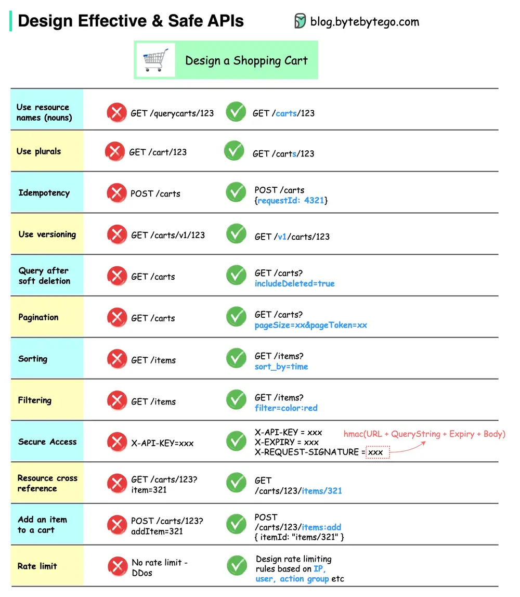

# ByteByteGo System Design 101: How to Design Effective and Safe APIs

> Copied from <https://github.com/ByteByteGoHq/system-design-101> (CC BY-NC-ND 4.0, by ByteByteGo). Questions and answers are the source's own; nothing was answered or rewritten here.

The diagram above shows typical API designs with a shopping cart example.

Note that API design is not just URL path design. Most of the time, we need to choose the proper resource names, identifiers, and path patterns. It is equally important to design proper HTTP header fields or to design effective rate-limiting rules within the API gateway.
