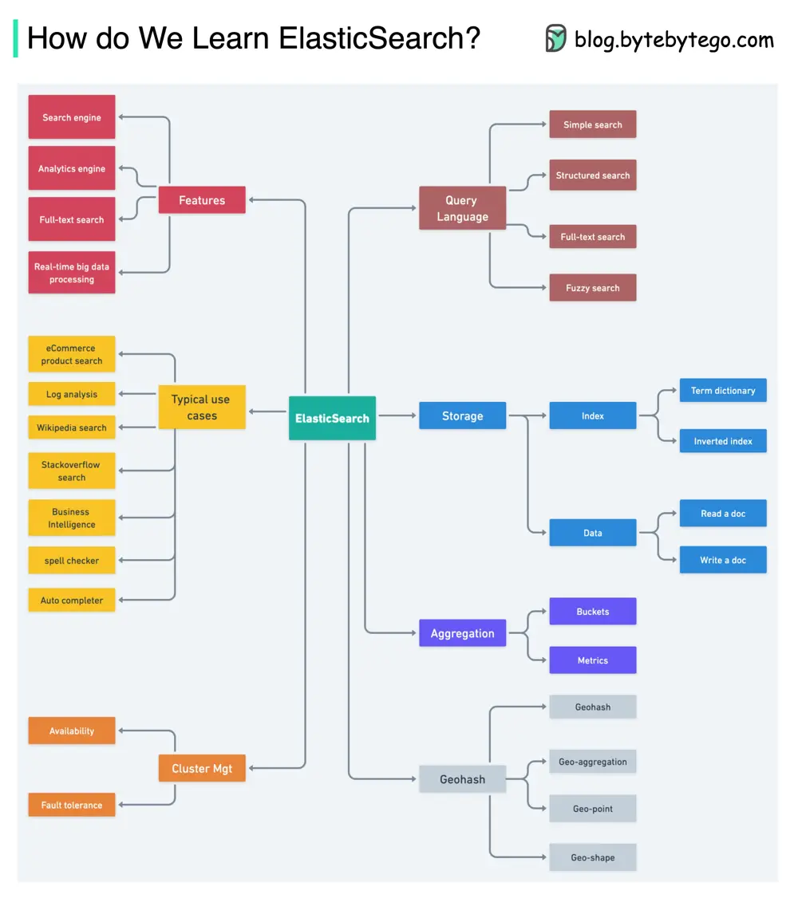

# ByteByteGo System Design 101: How to Learn Elasticsearch

> Copied from <https://github.com/ByteByteGoHq/system-design-101> (CC BY-NC-ND 4.0, by ByteByteGo). Questions and answers are the source's own; nothing was answered or rewritten here.

Based on the Lucene library, Elasticsearch provides search capabilities. It provides a distributed, multitenant-capable full-text search engine with an HTTP web interface and schema-free JSON documents. The diagram above shows the outline.

## Features of ElasticSearch:

* Real-time full-text search
* Analytics engine
* Distributed Lucene

## ElasticSearch use cases:

* Product search on an eCommerce website
* Log analysis
* Auto completer, spell checker
* Business intelligence analysis
* Full-text search on Wikipedia
* Full-text search on StackOverflow

The core of ElasticSearch lies in the data structure and indexing. It is important to understand how ES builds the **term dictionary** using **LSM Tree** (Log-Strucutured Merge Tree).
