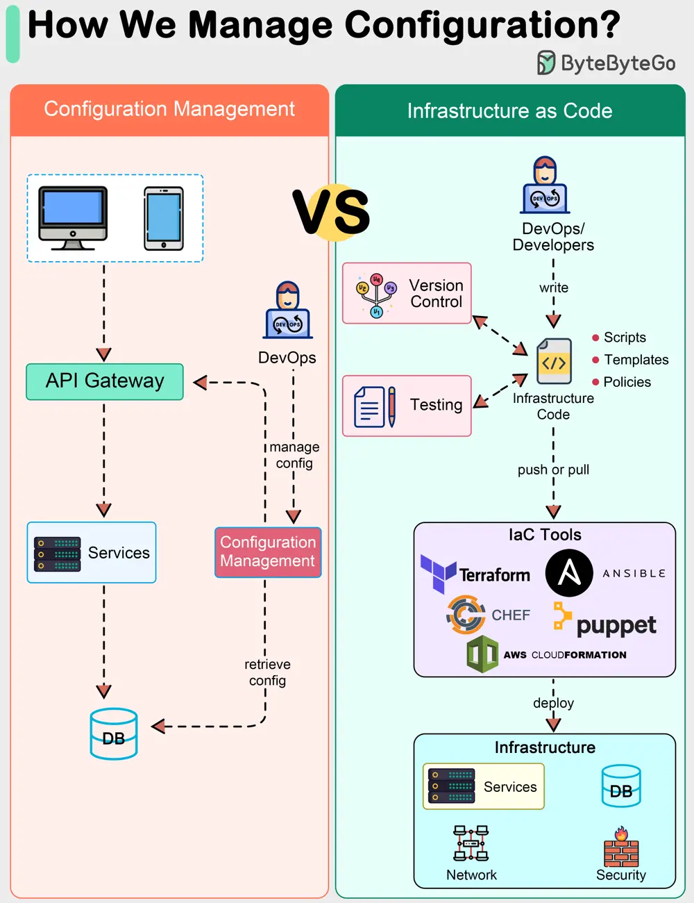

# ByteByteGo System Design 101: How do we manage configurations in a system?

> Copied from <https://github.com/ByteByteGoHq/system-design-101> (CC BY-NC-ND 4.0, by ByteByteGo). Questions and answers are the source's own; nothing was answered or rewritten here.

The diagram shows a comparison between traditional configuration management and IaC (Infrastructure as Code).

## Configuration Management

Configuration Management is designed to manage and provision IT infrastructure through systematic and repeatable processes. This is critical for ensuring that the system performs as intended.

Traditional configuration management focuses on maintaining the desired state of the system's configuration items, such as servers, network devices, and applications, after they have been provisioned.

It usually involves initial manual setup by DevOps. Changes are managed by step-by-step commands.

## What is IaC?

IaC, on the other hand, represents a shift in how infrastructure is provisioned and managed, treating infrastructure setup and changes as software development practices.

IaC automates the provisioning of infrastructure, starting and managing the system through code. It often uses a declarative approach, where the desired state of the infrastructure is described.

Tools like Terraform, AWS CloudFormation, Chef, and Puppet are used to define infrastructure in code files that are source controlled.

IaC represents an evolution towards automation, repeatability, and the application of software development practices to infrastructure management.
