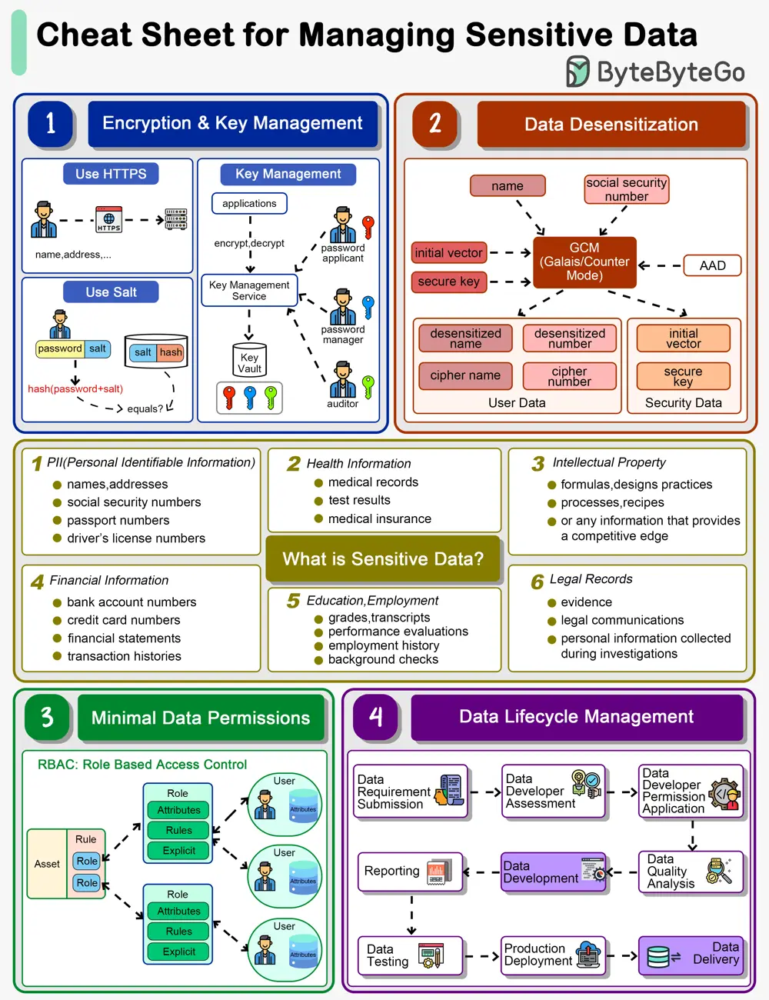

# ByteByteGo System Design 101: How do we manage sensitive data in a system?

> Copied from <https://github.com/ByteByteGoHq/system-design-101> (CC BY-NC-ND 4.0, by ByteByteGo). Questions and answers are the source's own; nothing was answered or rewritten here.

The cheat sheet below shows a list of guidelines.

## What is Sensitive Data?

Personal Identifiable Information (PII), health information, intellectual property, financial information, education and legal records are all sensitive data.

Most countries have laws and regulations that require the protection of sensitive data. For example, the General Data Protection Regulation (GDPR) in the European Union sets stringent rules for data protection and privacy. Non-compliance with such regulations can result in hefty fines, legal actions, and sanctions against the violating entity.

When we design systems, we need to design for data protection.

## Encryption & Key Management

The data transmission needs to be encrypted using SSL. Passwords shouldn’t be stored in plain text.

For key storage, we design different roles including password applicant, password manager and auditor, all holding one piece of the key. We will need all three keys to open a lock.

## Data Desensitization

Data desensitization, also known as data anonymization or data sanitization, refers to the process of removing or modifying personal information from a dataset so that individuals cannot be readily identified. This practice is crucial in protecting individuals' privacy and ensuring compliance with data protection laws and regulations. Data desensitization is often used when sharing data externally, such as for research or statistical analysis, or even internally within an organization, to limit access to sensitive information.

Algorithms like GCM store cipher data and keys separately so that hackers are not able to decipher the user data.

## Minimal Data Permissions

To protect sensitive data, we should grant minimal permissions to the users. Often we design Role-Based Access Control (RBAC) to restrict access to authorized users based on their roles within an organization. It is a widely used access control mechanism that simplifies the management of user permissions, ensuring that users have access to only the information and resources necessary for their roles.

## Data Lifecycle Management

When we develop data products like reports or data feeds, we need to design a process to maintain data quality. Data developers should be granted with necessary permissions during development. After the data is online, they should be revoked from the data access.
