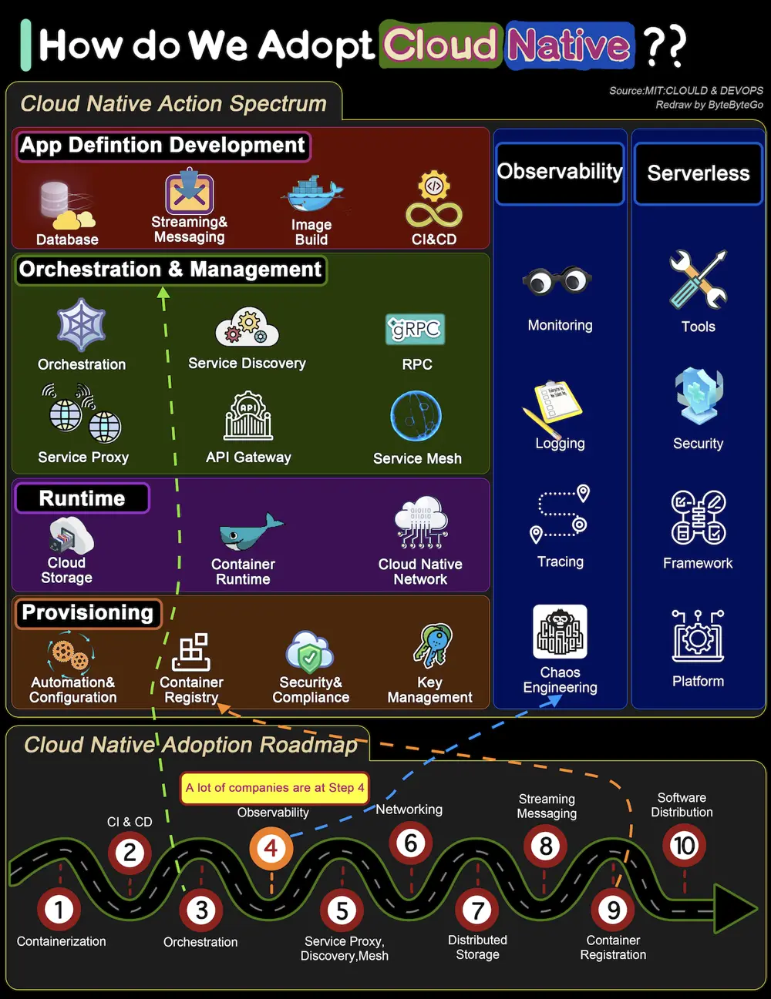

# ByteByteGo System Design 101: How to Transform a System to be Cloud Native

> Copied from <https://github.com/ByteByteGoHq/system-design-101> (CC BY-NC-ND 4.0, by ByteByteGo). Questions and answers are the source's own; nothing was answered or rewritten here.

The diagram below shows the action spectrum and adoption roadmap. You can use it as a blueprint for adopting cloud-native in your organization.

For a company to adopt cloud native architecture, there are 6 aspects in the spectrum:

*   Application definition development
*   Orchestration and management
*   Runtime
*   Provisioning
*   Observability
*   Serverless
