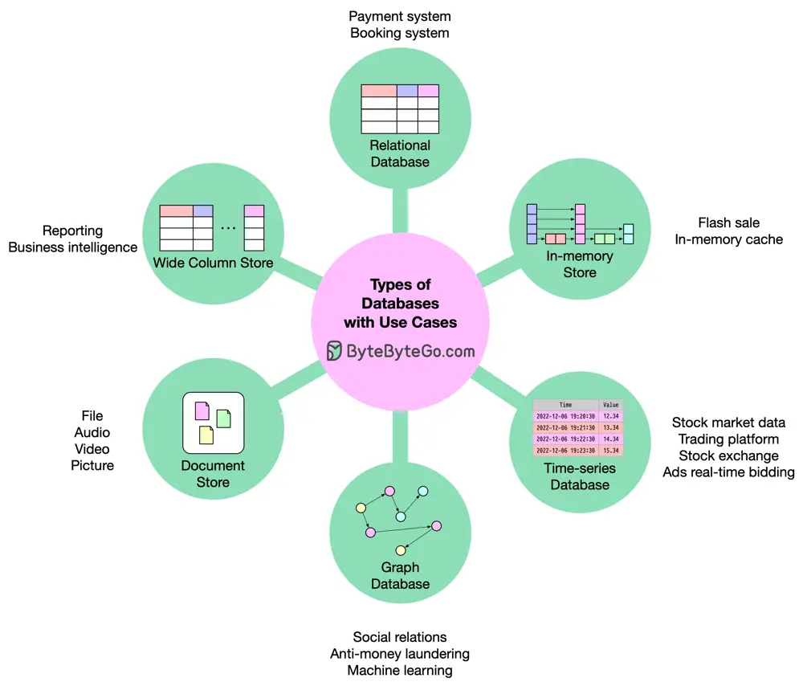

# ByteByteGo System Design 101: How to Decide Which Type of Database to Use

> Copied from <https://github.com/ByteByteGoHq/system-design-101> (CC BY-NC-ND 4.0, by ByteByteGo). Questions and answers are the source's own; nothing was answered or rewritten here.

There are hundreds or even thousands of databases available today, such as Oracle, MySQL, MariaDB, SQLite, PostgreSQL, Redis, ClickHouse, MongoDB, S3, Ceph, etc. How do you select the architecture for your system? My short summary is as follows:

## Database Types

*   Relational database: Almost anything could be solved by them.

*   In-memory store: Their speed and limited data size make them ideal for fast operations.

*   Time-series database: Store and manage time-stamped data.

*   Graph database: It is suitable for complex relationships between unstructured objects.

*   Document store: They are good for large immutable data.

*   Wide column store: They are usually used for big data, analytics, reporting, etc., which needs denormalized data.
