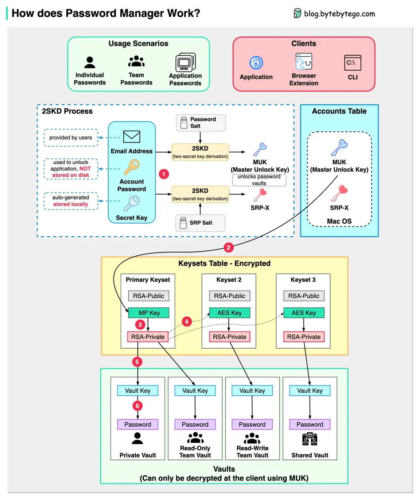

# ByteByteGo System Design 101: How Password Managers Work

> Copied from <https://github.com/ByteByteGoHq/system-design-101> (CC BY-NC-ND 4.0, by ByteByteGo). Questions and answers are the source's own; nothing was answered or rewritten here.

How does it keep our passwords safe?

The diagram below shows how a typical password manager works.

A password manager generates and stores passwords for us. We can use it via application, browser extension, or command line.

Not only does a password manager store passwords for individuals but also it supports password management for teams in small businesses and big enterprises.

Let’s go through the steps.

## Step 1

When we sign up for a password manager, we enter our email address and set up an account password. The password manager generates a secret key for us. The 3 fields are used to generate MUK (Master Unlock Key) and SRP-X using the 2SKD algorithm. MUK is used to decrypt vaults that store our passwords. Note that the secret key is stored locally, and will not be sent to the password manager’s server side.

## Step 2

The MUK generated in Step 1 is used to generate the encrypted MP key of the primary keyset.

## Steps 3-5

The MP key is then used to generate a private key, which can be used to generate AES keys in other keysets. The private key is also used to generate the vault key. Vault stores a collection of items for us on the server side. The items can be passwords notes etc.

## Step 6

The vault key is used to encrypt the items in the vault.

Because of the complex process, the password manager has no way to know the encrypted passwords. We only need to remember one account password, and the password manager will remember the rest.
