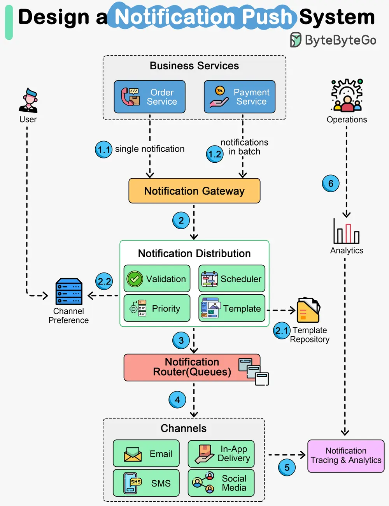

# ByteByteGo System Design 101: How Does a Typical Push Notification System Work?

> Copied from <https://github.com/ByteByteGoHq/system-design-101> (CC BY-NC-ND 4.0, by ByteByteGo). Questions and answers are the source's own; nothing was answered or rewritten here.

The diagram above shows the architecture of a notification system that covers major notification channels:

*   **In-App notifications**
*   **Email notifications**
*   **SMS and OTP notifications**
*   **Social media pushes**

Let’s walk through the steps.

*   Steps 1.1 and 1.2 - The business services send notifications to the notification gateway. The gateway can handle two modes: one mode receives one notification each time, and the other receives notifications in batches.
*   Steps 2, 2.1, and 2.2 - The notification gateway forwards the notifications to the distribution service, where the messages are validated, formatted, and scheduled based on settings. The notification template repository allows users to pre-define the message format. The channel preference repository allows users to pre-define the preferred delivery channels.
*   Step 3 - The notifications are then sent to the routers, normally message queues.
*   Step 4 - The channel services communicate with various internal and external delivery channels, including in-app notifications, email delivery, SMS delivery, and social media apps.
*   Steps 5 and 6 - The delivery metrics are captured by the notification tracking and analytics service, where the operations team can view the analytical reports and improve user experiences.
