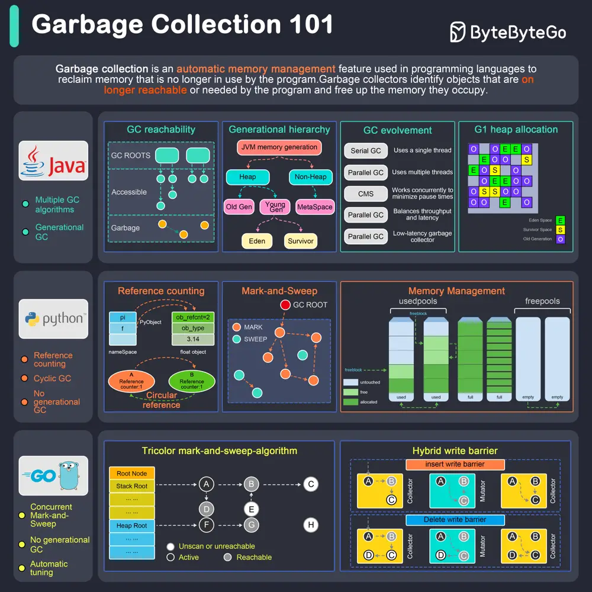

# ByteByteGo System Design 101: How does Garbage Collection work?

> Copied from <https://github.com/ByteByteGoHq/system-design-101> (CC BY-NC-ND 4.0, by ByteByteGo). Questions and answers are the source's own; nothing was answered or rewritten here.

Garbage collection is an automatic memory management feature used in programming languages to reclaim memory no longer used by the program.

## Java

Java provides several garbage collectors, each suited for different use cases:

*   Serial Garbage Collector: Best for single-threaded environments or small applications.

*   Parallel Garbage Collector: Also known as the "Throughput Collector."

*   CMS (Concurrent Mark-Sweep) Garbage Collector: Low-latency collector aiming to minimize pause times.

*   G1 (Garbage-First) Garbage Collector: Aims to balance throughput and latency.

*   Z Garbage Collector (ZGC): A low-latency garbage collector designed for applications that require large heap sizes and minimal pause times.

## Python

Python's garbage collection is based on reference counting and a cyclic garbage collector:

*   Reference Counting: Each object has a reference count; when it reaches zero, the memory is freed.

*   Cyclic Garbage Collector: Handles circular references that can't be resolved by reference counting.

## GoLang

Concurrent Mark-and-Sweep Garbage Collector: Go's garbage collector operates concurrently with the application, minimizing stop-the-world pauses.
