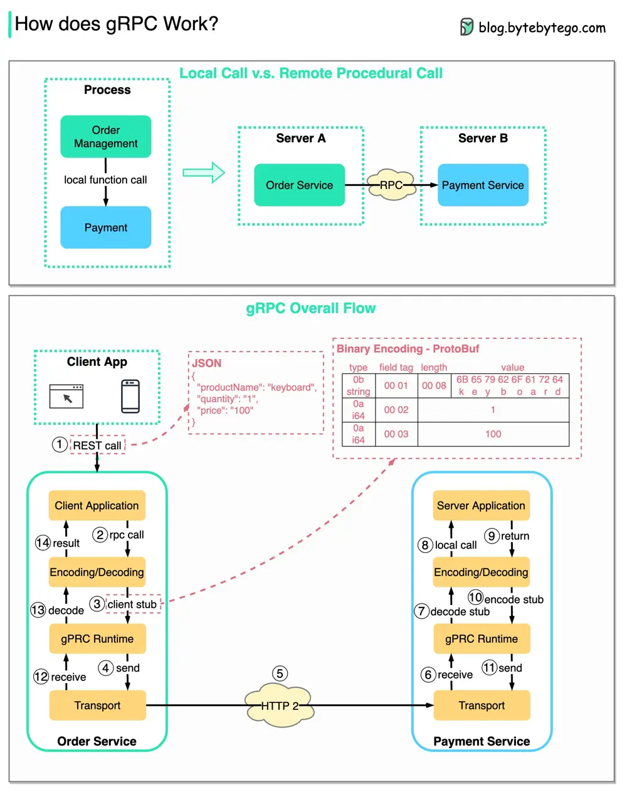

# ByteByteGo System Design 101: How does gRPC work?

> Copied from <https://github.com/ByteByteGoHq/system-design-101> (CC BY-NC-ND 4.0, by ByteByteGo). Questions and answers are the source's own; nothing was answered or rewritten here.

RPC (Remote Procedure Call) is called **“remote”** because it enables communications between remote services when services are deployed to different servers under microservice architecture. From the user’s point of view, it acts like a local function call.

The diagram above illustrates the overall data flow for **gRPC.**

*   Step 1: A REST call is made from the client. The request body is usually in JSON format.

*   Steps 2 - 4: The order service (gRPC client) receives the REST call, transforms it, and makes an RPC call to the payment service. gPRC encodes the **client stub** into a binary format and sends it to the low-level transport layer.

*   Step 5: gRPC sends the packets over the network via HTTP2. Because of binary encoding and network optimizations, gRPC is said to be 5X faster than JSON.

*   Steps 6 - 8: The payment service (gRPC server) receives the packets from the network, decodes them, and invokes the server application.

*   Steps 9 - 11: The result is returned from the server application, and gets encoded and sent to the transport layer.

*   Steps 12 - 14: The order service receives the packets, decodes them, and sends the result to the client application.
