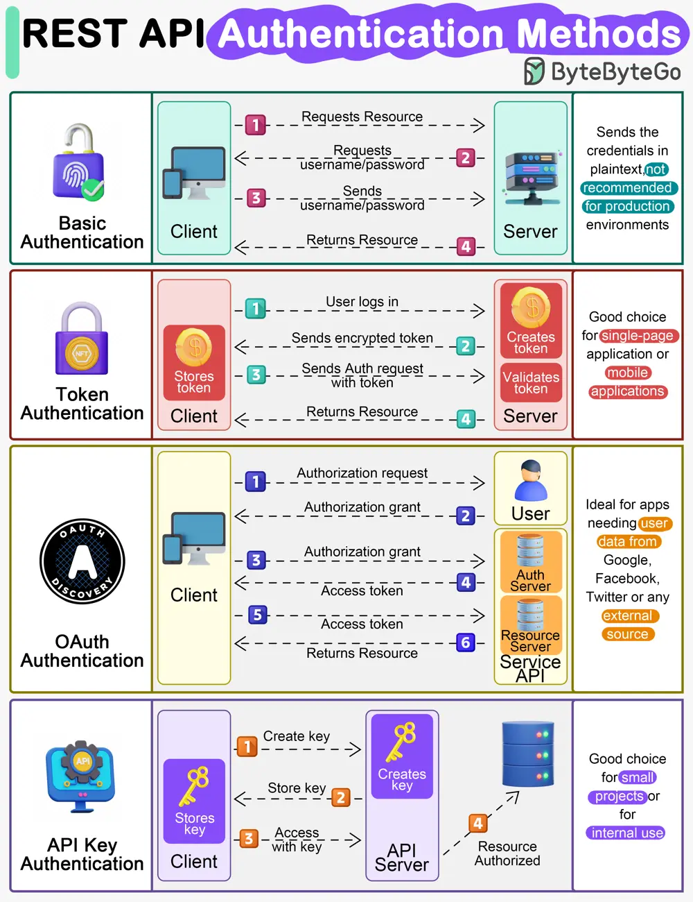

# ByteByteGo System Design 101: How does REST API work?

> Copied from <https://github.com/ByteByteGoHq/system-design-101> (CC BY-NC-ND 4.0, by ByteByteGo). Questions and answers are the source's own; nothing was answered or rewritten here.

What are its principles, methods, constraints, and best practices?

I hope the diagram above gives you a quick overview.

