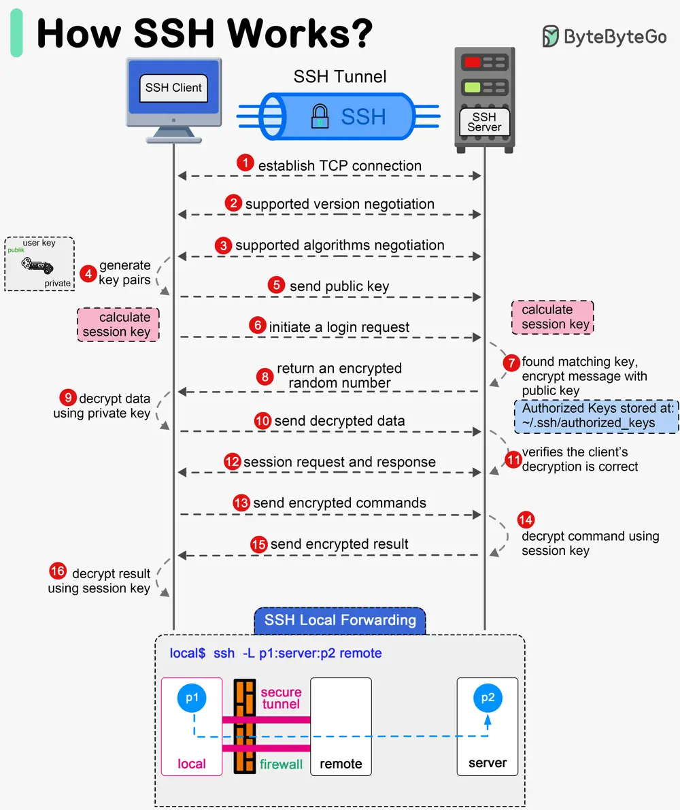

# ByteByteGo System Design 101: How does SSH work?

> Copied from <https://github.com/ByteByteGoHq/system-design-101> (CC BY-NC-ND 4.0, by ByteByteGo). Questions and answers are the source's own; nothing was answered or rewritten here.

SSH (Secure Shell) is a network protocol used to securely connect to remote machines over an unsecured network. It encrypts the connection and provides various mechanisms for authentication and data transfer.

SSH has two versions: SSH-1 and SSH-2. SSH-2 was standardized by the IETF.

It has three main layers: Transport Layer, Authentication Layer, and Connection Layer.

## Transport Layer

The Transport Layer provides encryption, integrity, and data protection to ensure secure communication between the client and server.

## Authentication Layer

The Authentication Layer verifies the identity of the client to ensure that only authorized users can access the server.

## Connection Layer

The Connection Layer multiplexes the encrypted and authenticated communication into multiple logical channels.
