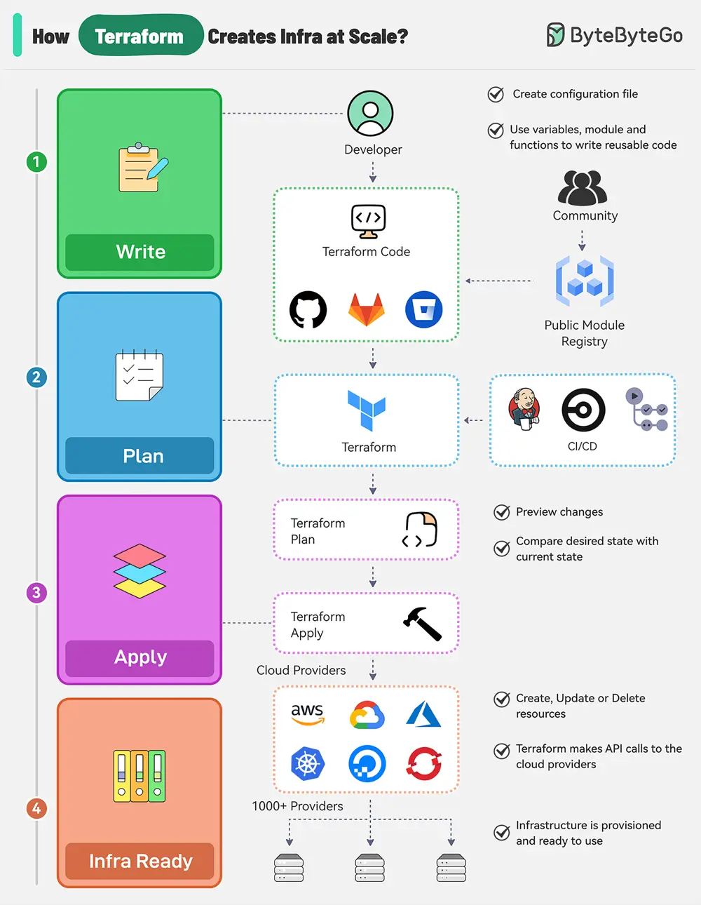

# ByteByteGo System Design 101: How does Terraform turn Code into Cloud?

> Copied from <https://github.com/ByteByteGoHq/system-design-101> (CC BY-NC-ND 4.0, by ByteByteGo). Questions and answers are the source's own; nothing was answered or rewritten here.

There are multiple stages in a Terraform workflow:

## Write Infrastructure as Code

*   Define resources, providers, and configurations in Terraform configuration files.

*   Use variables, modules, and functions to make the code reusable and maintainable.

*   Integrate with Terraform community registries for ready-to-use modules.

## Terraform Plan

Preview the changes Terraform will make to the infrastructure by running “terraform plan”. It can be triggered as part of a CI/CD pipeline.

Terraform compares the desired state defined in the configuration file with the current state in the state file.

## Terraform Apply

Run “terraform apply” to create, update, or delete resources based on the plan.

Terraform makes API calls to the specified providers (AWS, Azure, GCP, Kubernetes, etc) to provision the resources.

The state file is updated to reflect the new state of the infrastructure.

## Infrastructure Ready

Terraform state file acts as a single source of truth for the current state of the infrastructure.

State file enables version control and collaboration between team members for future changes.
