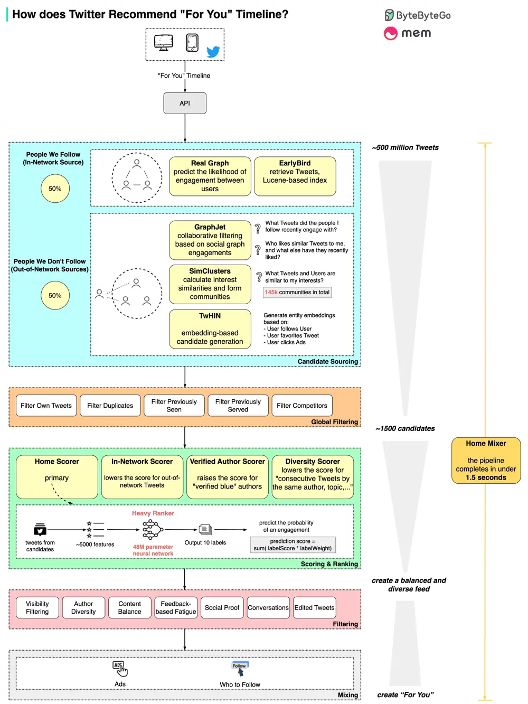

# ByteByteGo System Design 101: How does Twitter recommend “For You” Timeline in 1.5 seconds?

> Copied from <https://github.com/ByteByteGoHq/system-design-101> (CC BY-NC-ND 4.0, by ByteByteGo). Questions and answers are the source's own; nothing was answered or rewritten here.

We spent a few days analyzing it.

The diagram above shows the detailed pipeline based on the open-sourced algorithm.

The process involves 5 stages:

*   **Candidate Sourcing** ~ start with 500 million Tweets
*   **Global Filtering** ~ down to 1500 candidates
*   **Scoring & Ranking** ~ 48M parameter neural network, Twitter Blue boost
*   **Filtering** ~ to achieve author and content diversity
*   **Mixing** ~ with Ads recommendation and Who to Follow

The post was jointly created by ByteByteGo and [Mem](https://www.linkedin.com/company/memdotai/). Special thanks [Scott Mackie](https://www.linkedin.com/in/ACoAABLDe9kBSK7DsORQHK2G1srZCmM1isaUun8), founding engineer at Mem, for putting this together.

Mem is building the world’s first knowledge assistant. In next week’s ByteByteGo guest newsletter, Mem will be sharing lessons they’ve learned from their extensive work with large language models and building AI-native infrastructure.
