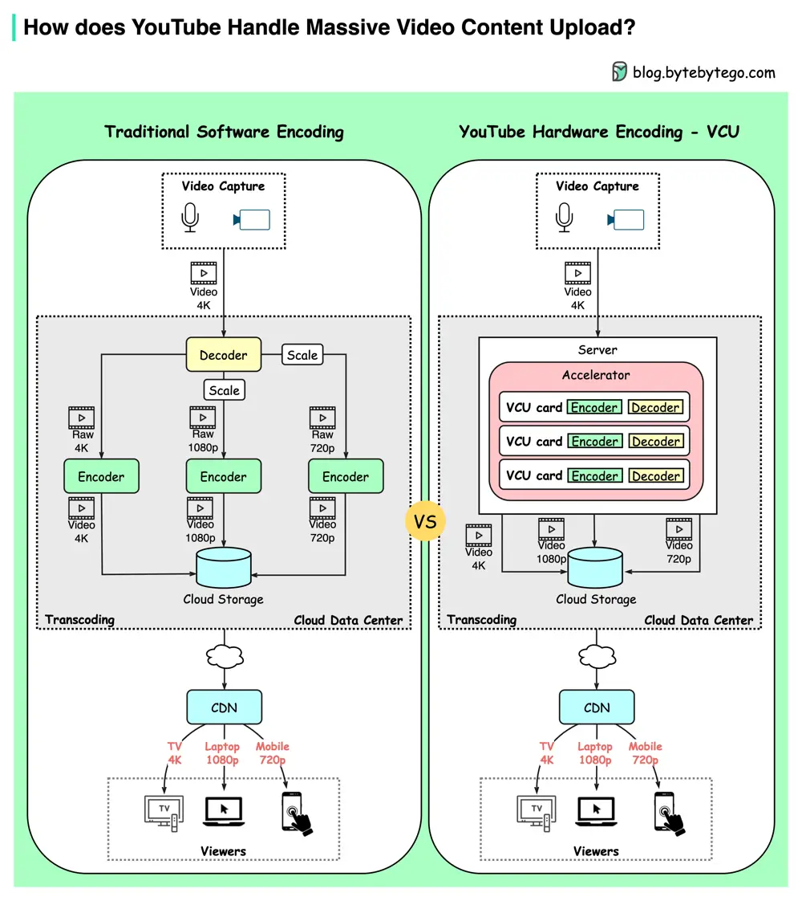

# ByteByteGo System Design 101: How YouTube Handles Massive Video Uploads

> Copied from <https://github.com/ByteByteGoHq/system-design-101> (CC BY-NC-ND 4.0, by ByteByteGo). Questions and answers are the source's own; nothing was answered or rewritten here.

YouTube handles 500+ hours of video content uploads every minute on average. How does it manage this?

The diagram above shows YouTube’s innovative hardware encoding published in 2021.

*   **Traditional Software Encoding**

YouTube’s mission is to transcode raw video into different compression rates to adapt to different viewing devices - mobile(720p), laptop(1080p), or high-resolution TV(4k).

Creators upload a massive amount of video content on YouTube every minute. Especially during the COVID-19 pandemic, video consumption is greatly increased as people are sheltered at home. Software-based encoding became slow and costly. This means there was a need for a specialized processing brain tailored made for video encoding/decoding.

*   **YouTube’s Transcoding Brain - VCU**

Like GPU or TPU was used for graphics or machine learning calculations, YouTube developed VCU (Video transCoding Unit) for warehouse-scale video processing.

Each cluster has a number of VCU accelerated servers. Each server has multiple accelerator trays, each containing multiple VCU cards. Each card has encoders, decoders, etc.

VCU cluster generates video content with different resolutions and stores it in cloud storage.

This new design brought 20-33x improvements in computing efficiency compared to the previous optimized system.
