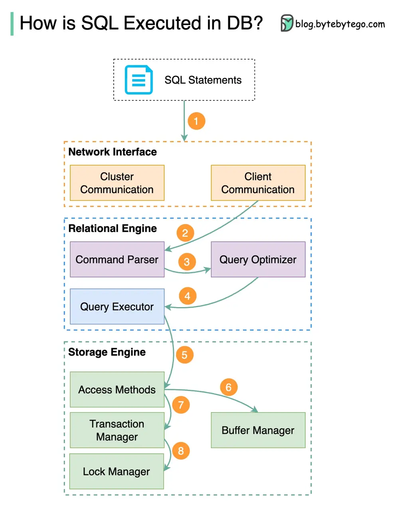

# ByteByteGo System Design 101: SQL Statement Execution in Database

> Copied from <https://github.com/ByteByteGoHq/system-design-101> (CC BY-NC-ND 4.0, by ByteByteGo). Questions and answers are the source's own; nothing was answered or rewritten here.

The diagram above shows the process. Note that the architectures for different databases are different, the diagram demonstrates some common designs.

## Step 1 - Transport Layer

A SQL statement is sent to the database via a transport layer protocol (e.g. TCP).

## Step 2 - Command Parser

The SQL statement is sent to the command parser, where it goes through syntactic and semantic analysis, and a query tree is generated afterward.

## Step 3 - Optimizer

The query tree is sent to the optimizer. The optimizer creates an execution plan.

## Step 4 - Executor

The execution plan is sent to the executor. The executor retrieves data from the execution.

## Step 5 - Access Methods

Access methods provide the data fetching logic required for execution, retrieving data from the storage engine.

## Step 6 - Buffer Manager (Read-Only Queries)

Access methods decide whether the SQL statement is read-only. If the query is read-only (SELECT statement), it is passed to the buffer manager for further processing. The buffer manager looks for the data in the cache or data files.

## Step 7 - Transaction Manager (Update/Insert)

If the statement is an UPDATE or INSERT, it is passed to the transaction manager for further processing.

## Step 8 - Lock Manager

During a transaction, the data is in lock mode. This is guaranteed by the lock manager. It also ensures the transaction’s ACID properties.
