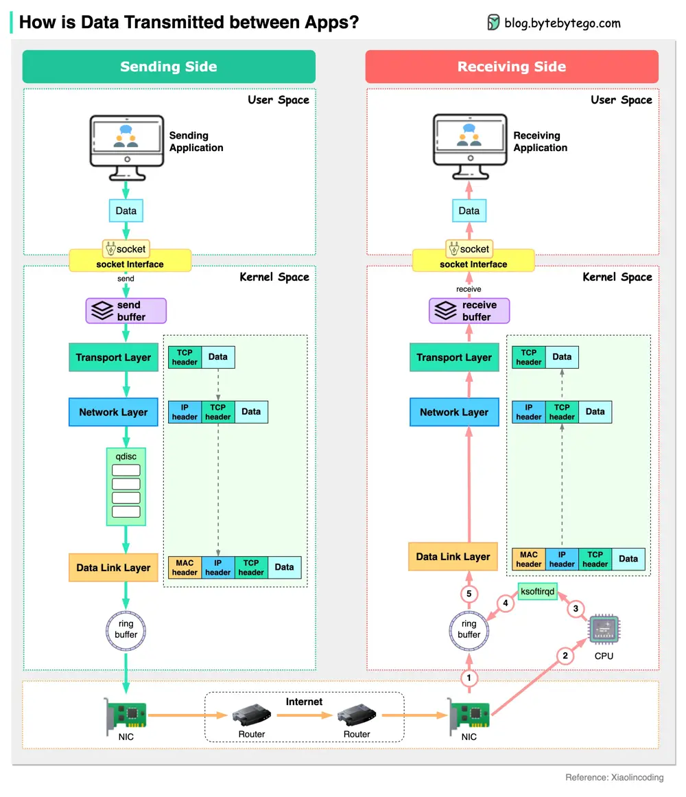

# ByteByteGo System Design 101: Data Transmission Between Applications

> Copied from <https://github.com/ByteByteGoHq/system-design-101> (CC BY-NC-ND 4.0, by ByteByteGo). Questions and answers are the source's own; nothing was answered or rewritten here.

The diagram below shows how a server sends data to another server.

Assume a chat application running in the user space sends out a chat message. The message is sent to the send buffer in the kernel space. The data then goes through the network stack and is wrapped with a TCP header, an IP header, and a MAC header. The data also goes through qdisc (Queueing Disciplines) for flow control. Then the data is sent to the NIC (Network Interface Card) via a ring buffer.

The data is sent to the internet via NIC. After many hops among routers and switches, the data arrives at the NIC of the receiving server.

The NIC of the receiving server puts the data in the ring buffer and sends a hard interrupt to the CPU. The CPU sends a soft interrupt so that ksoftirqd receives data from the ring buffer. Then the data is unwrapped through the data link layer, network layer and transport layer. Eventually, the data (chat message) is copied to the user space and reaches the chat application on the receiving side.
